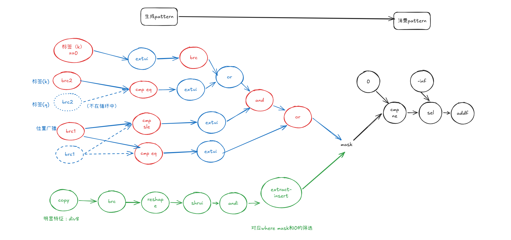

需要识别使用pattern和生成pattern


## 掩码生成pattern

转换成ir之后分为两类， 
1. 根据偏移计算 （蓝色）

   代表了一下的语义
   ```
   ((qpos <= kpos) & ((qtag == ktag) | (ktag == 0))) | (qpos == kpos)
   ```

   - 跳过`ext(i1->i8)`操作
   - 跳过形状变换： tensor.expand_shape/tensor.collapse_shape

2. 根据load+解压缩 （绿色）

```
紧凑字节加载 -> broadcast -> reshape -> shrui -> andi 1 -> 有效列提取并插入零张量 -> 非零判断 -> 偏置 select。
```
只有右移结果与常量 1 进行 andi 才作为位提取证据；普通位与不能单独构成该模式。

## 掩码使用pattern

使用pattern如下， 
```
掩码生成pattern
   ↓
整数 mask != 0
   ↓
select(predicate, 0.0, -2^30)
   ↓
addf(QK × scale, mask_bias)
```

识别 `arith.addf(scaled_matmul/matmul, bias)`，支持交换两侧：

- scaled_matmul 是 arith.mulf，其中一侧直接定义于 linalg.matmul。
- bias 是 arith.select，两个分支为浮点零和负的非 NaN 常量，支持交换极性及负无穷。
- 常量同时支持标量/稠密 splat 常量，以及由这些标量常量生成的 linalg.fill；非均匀常量不匹配。
- bias 与 addf 在同一 MLIR Block，分别有有效且不同的计算块编号；消费者必须是 VECTOR。


<!-- 
# 必要性测试

分析q2/q3/zj/mojo的算子，首先筛选潜在可能需要mask的算子：
1. dsl中存在where的
2. 存在cv交互的
3. 有显式mask_io的
上述条件的算子共113个


# 充分性测试
 -->
