# CVPipeline Flash Attention Optimization on Ascend A5

## How the Current CVPipeline Runs Flash Attention on Ascend

The original CVPipeline overlaps Cube and Vector work **within one query block**. For each key tile, Cube computes the scores (`Q × Kᵀ`), Vector computes the softmax weights `P`, Cube computes `P × V`, and Vector updates the running output. While Vector works on one tile, Cube can compute scores for the next tile of the same query block. At the end of the block, the pipeline finishes its remaining stages before starting the next query block.

## How Our Optimizations Improve Scheduling and Memory Use

The compiler overlaps work across query blocks, reduces temporary reads and writes in Vector, and reuses Cube operands when they fit in local memory. For example, Vector can use the same exponential result for both the row sum and the FP16 weights.

### Scheduling Across Query Blocks

Both tables follow **two query blocks, Q0 and Q1, with four key tiles each**. The iteration index counts logical pipeline steps across both blocks. Bold cells trace Q1's first tile. A dash means the stage has no tile to process.

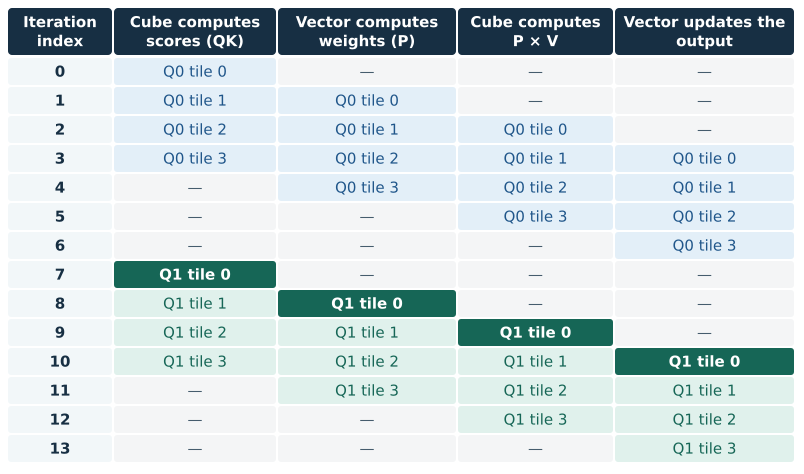

In the original schedule, Q0 issues its last QK at iteration 3. Iterations 4–6 finish Q0's remaining work. Q1 starts at iteration 7 with only the QK stage active. QK and PV share the Cube engine, so actual execution time depends on when that engine and its inputs are ready.

The main scheduling change is **loop coalescing**, which combines the query loop and the key-tile loop into **one continuous loop**. Cube can start computing scores for query block 1 while Vector finishes the output for query block 0. Separate buffers for each active block’s running sums and maxima keep both sets of values available.

With the same inputs, Q1 starts at **iteration 4** while the other three stages still have work from Q0. Q1's final output update moves from iteration 13 to iteration 10.

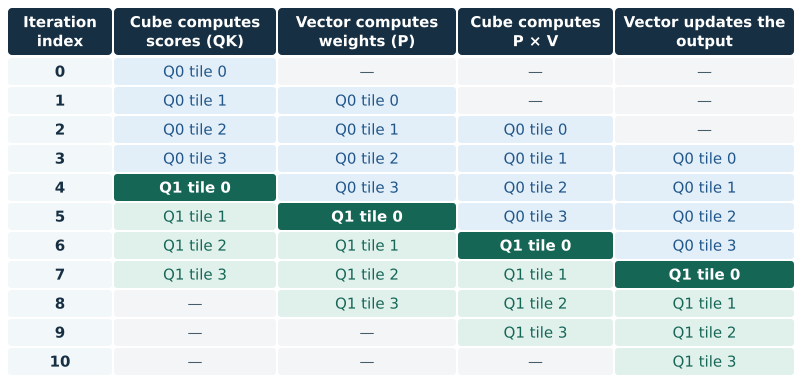

## 1. How Flash Attention Computes Query Blocks

For one batch and head, a task owns a query block `Q` of `BM` rows. It visits `K` and `V` in tiles of `BN` keys. `HD` is the number of elements in each query, key, or value row. The common configuration uses contiguous FP16 tensors in `[batch, head, sequence, head_dimension]` order, with 128 batches, eight heads, full key tiles, noncausal attention and no dropout.

| Head dimension | Query rows per block (`BM`) | Keys per tile (`BN`) |
| ---: | ---: | ---: |
| 64 | 128 | 256 |
| 128 | 128 | 128 |

Each query row carries a running maximum `m`, a running sum `l`, and an FP32 output accumulator `Oacc`. The maximum keeps the exponential weights in range. When a new tile increases the maximum, `alpha` rescales the sum and accumulator from the preceding tiles.

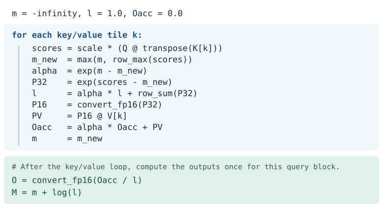

The example uses the kernel's scale of `0.5`. The matcher reads the scale and initial values from the program. For a finite first tile maximum, `alpha` is zero on the first iteration. The row sum consumes the FP32 weights before conversion to FP16. The final division normalizes the output across all key tiles, and `M` holds one log-sum-exp value per query row.

The diagram shows how Ascend maps this calculation onto Cube and Vector for one key tile. The FP32 weights feed the row sum, while the FP16 weights feed the second matmul.

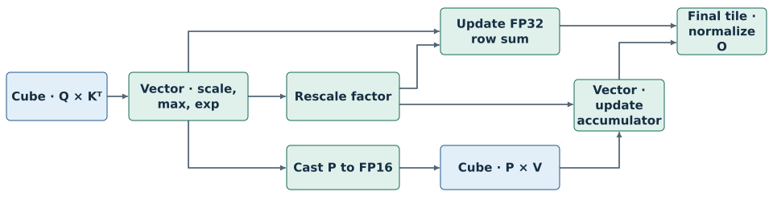

### Where the data lives in Ascend

| Hardware | Role in the calculation |
| --- | --- |
| AIC (Cube) | Executes the QK and PV matrix multiplications on the same matrix engine. |
| AIV (Vector) | Computes softmax and updates the output. Two Vector subcores partition the query rows. |
| UB (unified buffer) | Holds Vector inputs, intermediate tiles, row state and final output buffers. |
| L1 | Stages matrix operands, including Q and the packed P tile for PV. |
| L0A and L0B | Feed the Cube matmul operands. A reusable Q tile can occupy a reserved part of L0B. |
| L0C and FIX | Cube writes its result into L0C. FIX transfers it to its destination. A new writer waits until FIX has finished reading any range it will reuse. |

## 2. How the compiler builds the pipeline

| Compiler step | What it does and why it runs here |
| --- | --- |
| Recognize the loop | `CVPipelinePreparePass` records an ordered chain of Cube and Vector stages, the values passed between them and the state carried between tiles. A matched running-softmax recurrence adds the roles of QK, P, PV and the accumulator. |
| Schedule and verify | Skew scheduling assigns each stage to a core and a pipeline step. The verifier compares the scheduled operations with the recorded stage order, matrix dimensions, dependencies, carried values and memory origins. |
| Choose the layout and combine loops | While Cube and Vector are still in one function, the compiler rewrites the connected score/P layout and coalesces the query loop with its key-tile loop. |
| Rewrite Vector work | After HFusion has built and vectorized the vector functions (VFs), the compiler can fuse their producers and consumers. It gives output and loop-carried state explicit destinations while tensor values are still visible. |
| Place buffers and synchronize | After bufferization, copy forwarding can redirect reads and writes to their final buffers. The local memory planner assigns offsets. Preload and synchronization establish when a stage may read a buffer or reuse it. |
| Lower Cube work | The compiler verifies cache ranges and completion events, applies the eligible readiness, overlap and drain rewrites, and selects the device matmul helpers. |

### Recognition and verification

`CubeVectorPipelineInfo` describes an eligible `scf.for` as alternating Cube and Vector stages. Each Cube stage has its own matrix dimensions and operands. Each Vector stage consumes a result from the preceding Cube stage. A subsequent Cube stage takes at least one operand from the preceding Vector stage. This also describes kernels with more than two matmuls.

The analysis follows tensor values, supported whole-buffer views and transfers with a unique writer. It records a producer and consumer for each dependency and the initial and yielded values for each loop-carried argument. An escaping alias, ambiguous writer or unknown side effect prevents the analysis from establishing those facts.

For running softmax, `matchRunningSoftmaxPattern` additionally traces the maximum, exponential, FP32 sum, FP16 cast and rescaled accumulator update. It checks that the narrowed weights reach the PV matmul. Each rewrite then checks the dimensions, types, uses and storage it needs. The structural plan can still describe a loop that has no running-softmax pattern.

Preparation attaches `hivm.cvp.plan` to a recognized loop and tags stage anchors with `hivm.cvp.stage`. After scheduling, a missing stage, changed dependency or invalid memory assignment fails verification. Later passes consume the verified summary and check the operations they intend to change.

### How several CVPipeline passes verify rewrites

The score-layout, loop-coalescing, copy-forwarding and Cube-cache passes each rewrite a private copy of the module. They apply the changes to the live IR only after verification succeeds.

The compiler also keeps a backup of the mixed Cube/Vector function for delayed cross-core synchronization. When a pass replaces the module body, the pass manager restores the filtered backup functions so the synchronization pass can trace the original stage dependencies.

## 3. Score layout and Vector work

### Keep one query row per Vector lane

Logically, `Q @ Kᵀ` gives a score tile indexed as `[query, key]`. The reduction-major rewrite makes Cube compute `K @ Qᵀ`, producing the scores directly as `[key, query]`. For `BM=128` and `BN=256`, the tile is `[256,128]`. With the query rows split over two Vector subcores, each subcore handles `[256,64]`.

**Score tile for two queries and three keys**

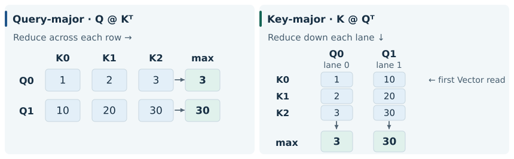

**Key-major layout avoids broadcasting each query's maximum across Vector lanes before subtraction.** Suppose the numbers above are the first tile of scaled scores. Both layouts subtract `m_new` before computing the exponential.

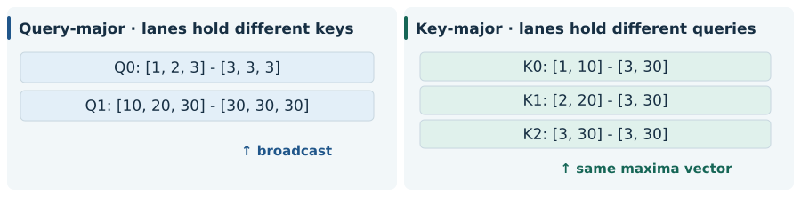

Vector loads `[3, 30]` once and reuses it for every key. Each lane subtracts its own query's maximum. The pass also adjusts the reduction axis, buffer shapes and P packing. PV reads the packed tile with `a_transpose` to compute `P @ V`.

### Vector Optimizations After the Layout Change

With one query per Vector lane, the compiler can change where scores are scaled, how weights reach Cube, and how the row maximum and sum are computed.

#### Recompute scaled scores where they are used

Both the row maximum and the exponential weights use the scaled scores. Take one query with raw QK scores `[2, 6, 4]` and scale `0.5`.

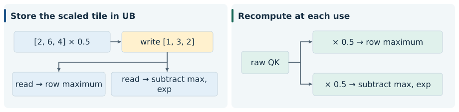

Repeating the multiply saves a full-tile write and two reads of the scaled temporary. The compiler checks that the raw QK tile stays available to both readers. Cube computes QK once.

#### Scale the maximum once per query row

The maximum calculation can do less work still. A positive scale preserves the order of the scores, so Vector can find the largest raw score first.

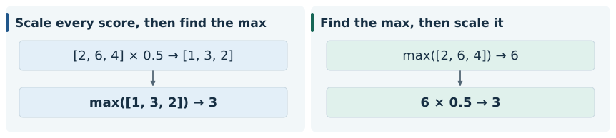

For this row, the maximum calculation goes from three multiplies to one. The exponential calculation still scales each score. The rewrite requires a positive finite scale and a compatible initial maximum.

#### Fuse the functions that produce weights

One Vector function computes the FP32 exponential weights. Another uses them for the row sum and the FP16 weights that PV needs. Fusion lets both uses read the result directly.

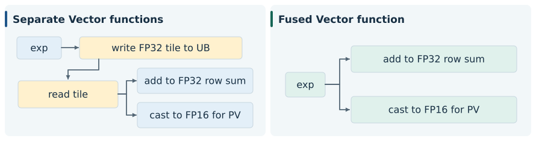

The intermediate FP32 tile disappears. When all the uses match, the compiler also brings the maximum and running-state update into the fused function. The sum uses the full-precision weights before rounding.

#### Pack two keys into one dense store

Each of the 64 Vector lanes produces one FP16 weight for its query. With 128 keys, Vector pairs key 0 with key 64, key 1 with key 65, and so on. Here `A` and `B` are the 64 weights for the first pair.

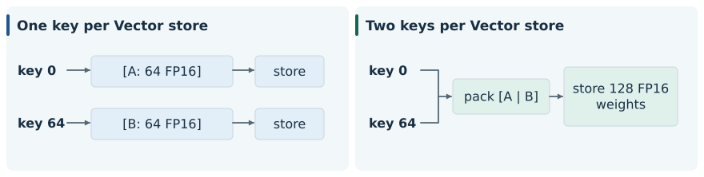

Inside the Vector function, `VFDeInterleaveOp(DENSE)` packs the 64 FP16 weights from `A` and the 64 from `B` into one vector with 128 consecutive lanes. A single **`vector.transfer_write`** writes that packed vector to the slice for this key pair in the same P buffer in UB. Each key pair uses a different slice. The buffer can still have padding between rows.

Two copies then place the groups into two subviews of the same L1 destination so Cube reads P in the order required for `P × V`. The compiler updates the buffer strides and the Vector function arguments to match this layout.

#### Split the reduction into two chains

With one running sum, each addition waits for the previous one. With two partial sums, Vector can advance one chain independently of the other and add their results at the end. For example, take four FP32 contributions to one query's row sum.

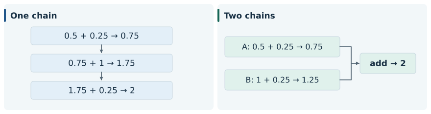

The packed sum uses two key groups. The maximum similarly reduces four key groups on two chains, then takes the larger of the two results.

### Which optimizations can change rounding?

FP32 rounds each addition. Changing the order of additions can slightly change the running sum `l`. That difference can reach both kernel outputs because `O` uses `Oacc / l` and `M` uses `m + log(l)`. The common configuration enables sum reassociation and FMA through separate options.

| Permission | Optimization | Where rounding can change |
| --- | --- | --- |
| `allow_cvp_sum_reassociation=True` | Reduction-major layout | Transposing scores preserves their values. Reducing along the new axis can change the order in which Vector adds weights across keys. |
| `allow_cvp_sum_reassociation=True` | Dense-P pairwise sum | Vector adds the FP32 weights from two keys together before adding the pair to the running sum. This happens even with one reduction chain. The FP16 packing instruction only rearranges lanes. |
| `allow_cvp_sum_reassociation=True` | Two reduction chains | Each chain rounds its own partial sum. A final addition combines the two results. |
| `enable_fused_multiply_add=True` | Fused multiply-add (FMA) | An eligible update such as `alpha * Oacc + PV` can round once at the end. Separate multiply and add instructions round the product first and the sum again. |

**Example for one query row.** Give keys K0 through K3 the FP32 weights `[1, t, t, t]`, where `t = 2⁻²⁴`. Under round-to-nearest, ties-to-even, `1 + t` rounds to `1`. Pairing two small weights first gives `2t = 2⁻²³`, which is large enough to reach the next FP32 value above `1`.

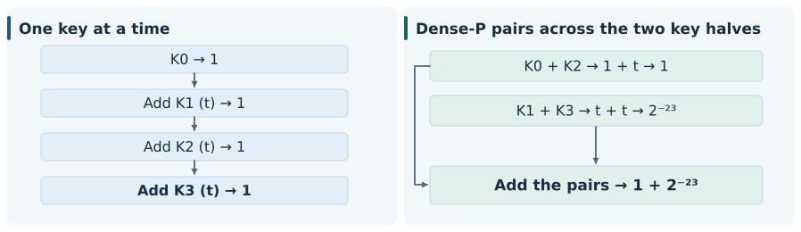

The two FP32 sums differ by one representable step in this example. The size and direction of the difference depend on the input values and the order of operations.

## 4. Scheduling across query blocks

The loop-coalescing pass (in MLIR terms called loop-coalescing while in LLVM called loop-flattening) combines a core's outer task loop and inner key-tile loop into one stream. `CVPStageIndexing` computes the task, tile and buffer slot for a given pipeline step. Each stage uses the coordinates for **its own** step. The table follows two query blocks, Q0 and Q1, with four key tiles each. Bold cells trace Q1’s first tile.

The table gives logical tile assignments. QK and PV share one Cube engine, and actual issue times depend on data transfers and completion signals. QK starts Q1 at iteration 4. Vector finishes Q0’s last output update at iteration 6. The pass preserves the core's starting task and stride. Each stage resets state on its first local tile and finalizes on its last local tile where required.

The running-softmax path knows which stages own the maximum, sum and accumulator. The structural path uses stage dependencies to build a stream with one of three state models:

| State model | How a later iteration reads the correct value |
| --- | --- |
| `stateless` | Stages consume their tile inputs and publish results without carrying numerical state to another tile. |
| `stage_local` | The owning stage resets its value on the first tile and reads its private UB state on subsequent tiles. |
| `history` | A stage saves values in indexed UB buffers so later stages can read the required tile's value after the producer advances. The verifier checks the writer, reader and slot before shifted execution. |

### How Overlapping Queries Keep Their State

#### Keep the sum and maximum for each active query

The P stage updates one running sum `l` and one running maximum `m` per query row. In the schedule above, P starts Q1 at iteration 5. The output stage still needs Q0’s final sum and maximum at iteration 6. Two pairs of UB buffers let both queries keep their values.

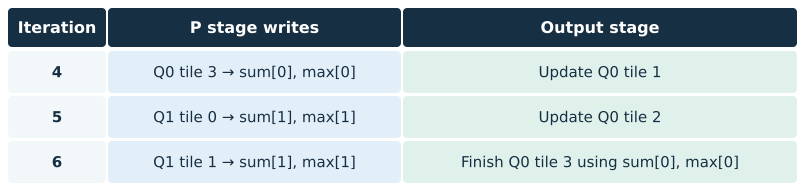

Each of the four buffers holds one FP32 value per local row. For 64 rows, each takes 256 bytes and all four use **1 KiB**. The output stage can use **one FP32 accumulator** (`Oacc`) because it finishes Q0 at iteration 6, then resets the accumulator for Q1 at iteration 7. At 64 local rows, `Oacc` uses 16 KiB for HD64 or 32 KiB for HD128.

#### Where each query block writes its results

After the last key tile, the query block’s attention output `O` and per-row log-sum-exp `M` are ready. Vector writes them to a pair of UB buffers, one for each result. The kernel then issues two UB-to-GM stores (`hivm.hir.store`), one to the `O` output tensor and one to the `M` output tensor in Ascend device global memory (GM).

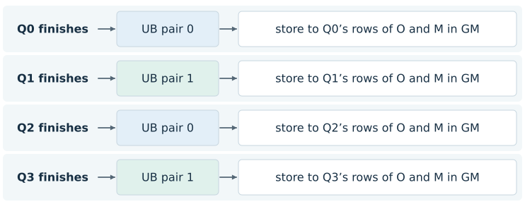

Q2 reuses UB pair 0 once Q0’s stores have finished reading it. Q3 does the same with Q1’s UB pair. Each query block has its own GM destination addresses, so Q0 and Q1 keep their stored results.

### Removing Copies from State and Output Buffers

Once a buffer’s readers and writers are known, the compiler can sometimes pass that buffer directly to a Vector function (VF). The four rewrites below target different copies.

#### Read the accumulator directly

`CVPStateCopyForward` removes a temporary copy of the **old** accumulator. Suppose an accumulator element holds 10. The update VF needs to read that 10 before the bank receives its next value.

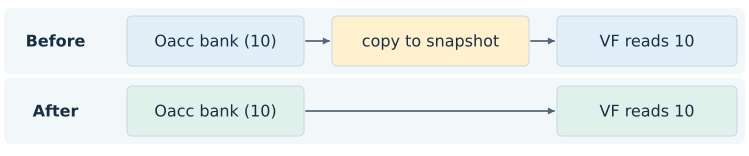

The compiler checks that the VF only reads this input and that the bank keeps its value until all those reads finish.

#### Write the accumulator update directly

`CVPOutputCopyForward` changes where the VF writes the **new** accumulator. For example, if `alpha = 0.5`, old `Oacc = 10` and `PV = 3`, the update gives `0.5 × 10 + 3 = 8`.

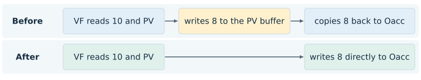

The compiler checks that the row update reads its inputs before overwriting them and that later users of the result can read it from the accumulator bank.

#### Write the final output directly

`CVPFinalOutputForward` removes a UB-to-UB copy on the **last** key tile. For Q1, `O[1]` is the selected UB output buffer. If the VF writes the complete output and the bank is safe to use, the compiler selects it before the VF call.

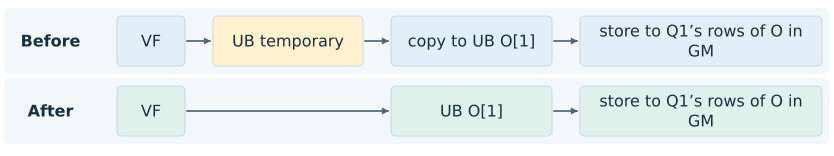

#### Read the sum and maximum directly

`CVPScalarInputForward` removes copies of the **previous** row sum and maximum that the P stage needs to compute the next tile’s weights. For example, on Q1’s second tile, both inputs come from slot 1. Each line below represents all local query rows.

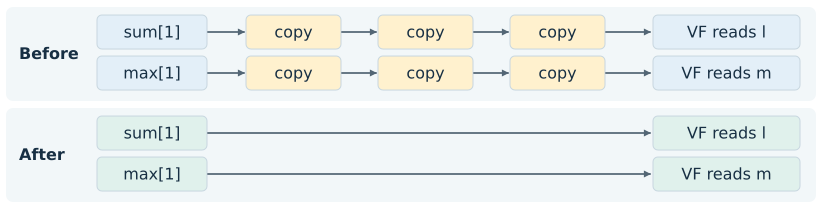

The first tile still uses the initial sum and maximum. On later tiles, the compiler removes these six copies when it can prove the VF reads the selected banks before the stage writes the new values. Across all four rewrites, an unknown memory access, an overlapping write or an intervening synchronization can prevent forwarding.

## 5. Cube operand caching and synchronization

### 5.1 Reusing Cube operands in L0B

Cube operand caching saves repeated transfers when several matrix multiplications use the same operand B. Cube loads the operand from L1 into L0B on its first use and reads the cached copy on later uses. The compiler checks that the value stays unchanged and that its L0B range fits alongside other live operands. The compiler and the device matmul template use the same size and alignment rules.

**Flash Attention example.** In the reduction-major QK matmul, Q is operand B. Query block Q0 uses the same Q tile with three different key tiles. PV uses a separate L0B range.

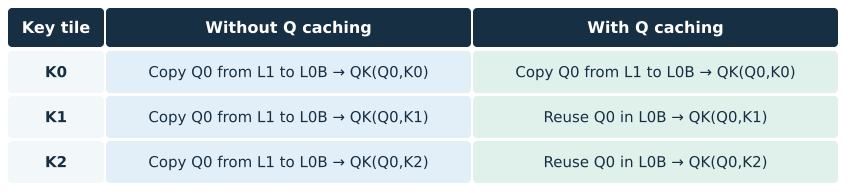

All three QK matmuls still run. Caching saves two L1-to-L0B copies of Q0 in this example.

The compiler also supports a function-wide cache when all Cube matmuls use one immutable B operand. For that path it tracks the first matmul that actually executes through loops and branches and checks that initialization completes before reuse.

The cache verifier checks ranges, initialization, the active query slot and the bank reuse protocol before helper lowering. In `cached` mode, a requested cache must match a supported layout. In `auto` mode, the compiler can use ordinary matmuls if the operand does not fit. A partially configured or inconsistent cache contract fails verification.

### 5.2 Overlapping Cube computation with result transfers

Cube writes each matrix result into L0C. FIX reads that result to transfer it out. While FIX is reading, Cube can start the next matmul if its inputs are ready and its result will go into a separate L0C range. If the new result would overwrite any data FIX is still reading, Cube must wait.

Both panels show the same work. FIX reads from L0C range A, and Cube has its inputs ready to write a result to range B. Before the pass, Cube waits for FIX. After the compiler verifies that A and B are disjoint and the wait protects no other dependency, Cube can start during the transfer. The bar lengths are illustrative.

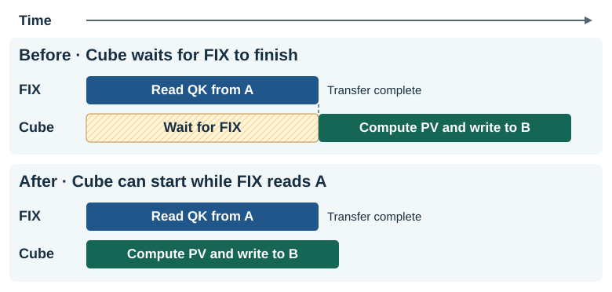

The overlap pass checks the actual L0C ranges and synchronization events before relaxing a wait. A separate check at the end of the stream finds the last iteration with Cube work and keeps the signals Vector needs to finish.

## 6. Compiler configuration

Triton's `NPUOptions` maps the Python options to native flags. Omitting a CVP option in Python generally leaves the native default in effect. The backend also tracks the compiler and template contents in the JIT cache key so changing either produces a separate compiled kernel. [Triton backend](../../third_party/ascend/backend/compiler.py) · [Toolchain identity](../../third_party/ascend/backend/toolchain.py)

The table lists the native defaults alongside the Flash Attention settings in the common recipe. The same settings apply to both head dimensions. In this recipe the head dimension determines the key tile size, and the actual buffer geometry determines whether automatic caching succeeds. [Native option definitions](https://gitcode.com/ebraheema/AscendNPU-IR/blob/82bfc81b00f79abcba55fd89591dcbaac571d8c7/bishengir/include/bishengir/Tools/bishengir-compile/Options.td) · [Recipe](../../third_party/ascend/benchmarks/cvp_attention/recipes.json)

| Python option | Native default | Common setting |
| --- | --- | --- |
| `enable_cvp_plan_analysis` | `False` | `True` |
| `enable_cvp_reduction_major_layout` | `False` | `True` |
| `enable_cvp_rematerialization` | `False` | `True` |
| `enable_cvp_reduction_scaling` | `False` | `True` |
| `enable_cvp_dense_operand` | `False` | `True` |
| `allow_cvp_sum_reassociation` | `False` | `True` |
| `cvp_stage_fusion` | `"none"` | `"reduce-exp-state"` |
| `cvp_reduction_chains` | `1` | `2` |
| `enable_cvp_persistent_pipeline` | `False` | `True` |
| `cvp_persistent_pipeline_mode` | `"skew"` | `"skew"` |
| `cvp_inner_unroll` | `1` | `1` |
| `enable_cvp_state_copy_forward` | `False` | `True` |
| `enable_cvp_final_output_forward` | `False` | `True` |
| `enable_cvp_output_copy_forward` | `False` | `True` |
| `enable_cvp_scalar_input_forward` | `False` | `True` |
| `cvp_invariant_cache_mode` | `"none"` | `"auto"` |
| `cvp_invariant_cache_consider_overlapping` | `True` | Inherit the native default |
| `enable_cvp_cube_banked_ready` | `False` | `True` |
| `enable_cvp_cube_overlap` | `False` | `True` |
| `enable_cvp_cube_derived_drain` | `False` | `True` |

The surrounding compiler settings enable mixed Cube/Vector compilation (`enable_mixed_cv=True`), preloading (`enable_preload=True`), VF operand substitution (`enable_vf_operand_substitution=True`) and fused multiply-add (`enable_fused_multiply_add=True`). The host also requests `multibuffer=True` and `enable_auto_bind_sub_block=True`.

The recipe keeps automatic cross-core synchronization enabled with `disable_auto_inject_block_sync=False` and `sync_solver=True`. Skew scheduling with inner unroll 1 preserves the stage coordinates used by loop coalescing. The backend enables buffer reuse protection when persistent scheduling is requested and the caller leaves that protection unspecified.

The native driver validates feature dependencies. For example, two reduction chains require dense P, the full reduction/exponential/state fusion, score rematerialization and permission to reassociate the FP32 sum. Automatic or forced caching requires banked readiness. Cube overlap and drain additionally require a compatible cache and synchronization protocol. [Driver validation](https://gitcode.com/ebraheema/AscendNPU-IR/blob/82bfc81b00f79abcba55fd89591dcbaac571d8c7/bishengir/lib/Tools/bishengir-compile/regbase/BiShengIRCompileMain.cpp)

## 7. Implementation entry points

| Where to look | Responsibility |
| --- | --- |
| [Stage analysis](https://gitcode.com/ebraheema/AscendNPU-IR/blob/82bfc81b00f79abcba55fd89591dcbaac571d8c7/bishengir/lib/Dialect/HIVM/Analysis/CubeVectorPipelineAnalysis.cpp) · [Running-softmax matcher](https://gitcode.com/ebraheema/AscendNPU-IR/blob/82bfc81b00f79abcba55fd89591dcbaac571d8c7/bishengir/lib/Dialect/HIVM/Analysis/RunningSoftmaxOpt/RunningSoftmaxPattern.cpp) | Establish the stage graph, trace the math and identify loop-carried state. |
| [Prepare and verify](https://gitcode.com/ebraheema/AscendNPU-IR/blob/82bfc81b00f79abcba55fd89591dcbaac571d8c7/bishengir/lib/Dialect/HIVM/Transforms/regbase/CVPipelinePrepare.cpp) · [HIVM pipeline](https://gitcode.com/ebraheema/AscendNPU-IR/blob/82bfc81b00f79abcba55fd89591dcbaac571d8c7/bishengir/lib/Dialect/HIVM/Pipelines/regbase/HIVMRegbasePipelines.cpp) · [Compiler pipeline](https://gitcode.com/ebraheema/AscendNPU-IR/blob/82bfc81b00f79abcba55fd89591dcbaac571d8c7/bishengir/lib/Tools/bishengir-compile/regbase/PassPipeline.cpp) | Mark the loop before scheduling, verify the result and order the transformations. |
| [Loop coalescing](https://gitcode.com/ebraheema/AscendNPU-IR/blob/82bfc81b00f79abcba55fd89591dcbaac571d8c7/bishengir/lib/Dialect/HIVM/Transforms/regbase/CVPLoopCoalescing.cpp) · [Stage indexing](https://gitcode.com/ebraheema/AscendNPU-IR/blob/82bfc81b00f79abcba55fd89591dcbaac571d8c7/bishengir/lib/Dialect/HIVM/Transforms/regbase/CVPStageIndexing.cpp) · [Stage stream helpers](https://gitcode.com/ebraheema/AscendNPU-IR/blob/82bfc81b00f79abcba55fd89591dcbaac571d8c7/bishengir/lib/Dialect/HIVM/Transforms/regbase/CVPStageStreamUtils.cpp) · [Compact softmax schedule](https://gitcode.com/ebraheema/AscendNPU-IR/blob/82bfc81b00f79abcba55fd89591dcbaac571d8c7/bishengir/lib/Dialect/HIVM/Transforms/regbase/RunningSoftmaxOpt/CVPCompactScheduling.cpp) | Build and verify the coalesced loop, including task boundaries and state ownership. |
| [Score layout](https://gitcode.com/ebraheema/AscendNPU-IR/blob/82bfc81b00f79abcba55fd89591dcbaac571d8c7/bishengir/lib/Dialect/HIVM/Transforms/regbase/RunningSoftmaxOpt/CVPReductionLayout.cpp) · [Vector rewrites](https://gitcode.com/ebraheema/AscendNPU-IR/blob/82bfc81b00f79abcba55fd89591dcbaac571d8c7/bishengir/lib/Dialect/HIVM/Transforms/regbase/RunningSoftmaxOpt/CVPVectorPatternRewrite.cpp) | Change QK/P layout, recompute or fuse vector expressions, pack P and split reductions. |
| [Output storage](https://gitcode.com/ebraheema/AscendNPU-IR/blob/82bfc81b00f79abcba55fd89591dcbaac571d8c7/bishengir/lib/Dialect/HIVM/Transforms/regbase/RunningSoftmaxOpt/OutputStorage.cpp) · [State storage](https://gitcode.com/ebraheema/AscendNPU-IR/blob/82bfc81b00f79abcba55fd89591dcbaac571d8c7/bishengir/lib/Dialect/HIVM/Transforms/regbase/RunningSoftmaxOpt/StateStorage.cpp) · [Forwarding](https://gitcode.com/ebraheema/AscendNPU-IR/blob/82bfc81b00f79abcba55fd89591dcbaac571d8c7/bishengir/lib/Dialect/HIVM/Transforms/regbase/CVPStateCopyForward.cpp) | Place final results and state in UB and redirect eligible reads and writes. |
| [Invariant cache](https://gitcode.com/ebraheema/AscendNPU-IR/blob/82bfc81b00f79abcba55fd89591dcbaac571d8c7/bishengir/lib/Dialect/HIVM/Transforms/regbase/CVPInvariantCache.cpp) · [Function-wide operand cache](https://gitcode.com/ebraheema/AscendNPU-IR/blob/82bfc81b00f79abcba55fd89591dcbaac571d8c7/bishengir/lib/Dialect/HIVM/Transforms/regbase/CVPInvariantOperand.cpp) · [Cube resource plan](https://gitcode.com/ebraheema/AscendNPU-IR/blob/82bfc81b00f79abcba55fd89591dcbaac571d8c7/bishengir/include/bishengir/Dialect/Utils/CVPCubeResourcePlan.h) · [Device matmul helpers](https://gitcode.com/ebraheema/AscendNPU-IR/blob/82bfc81b00f79abcba55fd89591dcbaac571d8c7/bishengir/lib/Template/lib/RegBase/Cube/LocalMmad.cpp) | Reserve Cube operand storage, verify bank reuse and lower matmuls to device code. |

## 8. Features disabled in the common configuration

| Setting | Effect |
| --- | --- |
| `enable_dynamic_cv_pipeline=False` | Uses the static Skew schedule. |
| `unit_flag=False` | Selects the synchronization mode used by the cached Cube helpers. Cross-core signals and waits remain enabled. |
| `disable_tightly_coupled_buffer_reuse=True` | Protects buffers that are still live in another stage from tightly coupled buffer reuse. |
| `cvp_inner_unroll=1` | Keeps a single copy of the inner tile body in the coalesced loop. The two reduction chains are inside the Vector calculation. |
