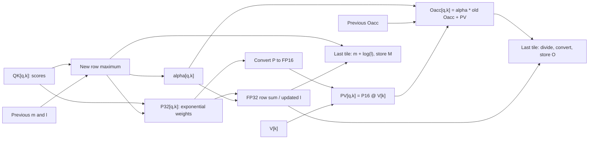
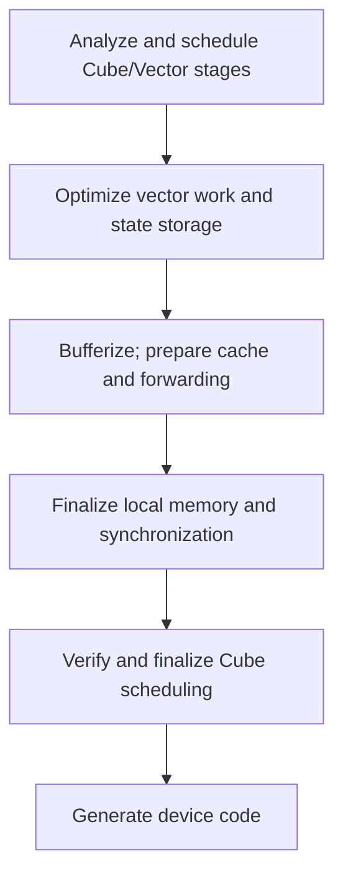
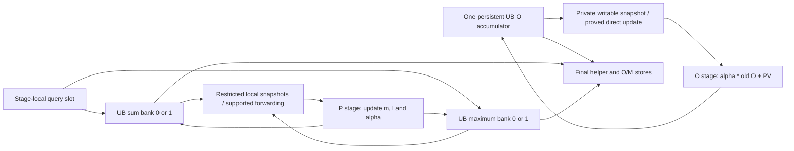
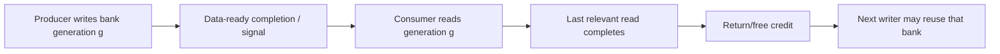
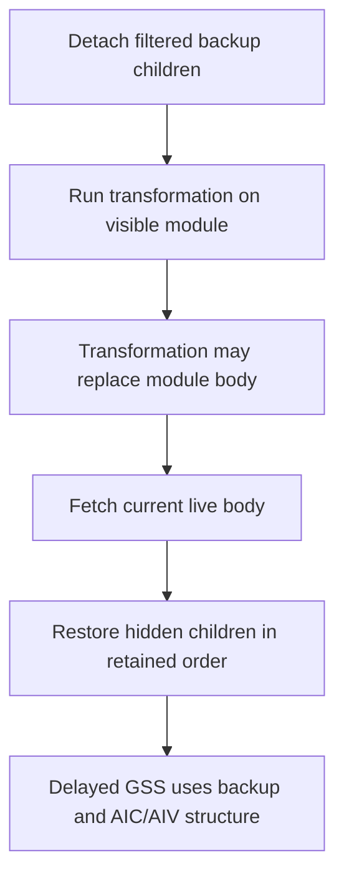

# CVPipeline Flash Attention on Ascend A5

0.6 review implementation is in progress. Qualification results below belong
to the retained 0.5 reference snapshots until fresh 0.6 validation is recorded.

Status: implementation-based design draft v2.1, for review; 0.6 generalization implemented in source, qualification pending

Review date: 2026-11-17

Implementation branch: `ebraheema/flashAtt/0.5.work` in Triton and AscendNPU-IR

## 1. Purpose and scope

The compiler optimizes the original Flash Attention forward kernel through normal Triton options, AscendNPU-IR transformations, packaged Cube templates. The retained policy changes intermediate layout, vector producers, persistent scheduling, state copies and supported Cube handoffs while preserving the calculation and measured native programs.

The current design separates two responsibilities. `CubeVectorPipelineInfo` describes a general ordered Cube/Vector chain, with per-matrix geometry, dependencies, carried state and a memory contract. Independent operation-pattern proofs specify whether a particular reduction/rescale, layout, storage or cache transformation is legal.

### 1.1 Terminology and hardware

| Term | Meaning in this design |
| --- | --- |
| `q` | One query block/task assigned to a physical core; successive tasks need not be adjacent query-row blocks |
| `k` | One KV tile within that query |
| `QK[q,k]` | Logical query-by-key scores |
| `P32[q,k]` / `P16[q,k]` | FP32 exponential weights / their FP16 conversion for Cube |
| `PV[q,k]` | Matrix contribution from `P16[q,k] @ V[k]` |
| `Oacc[q,k]` | Running FP32 output accumulator after tile `k` |
| AIC / Cube | Matrix engine; QK and PV use the same matrix-compute resource |
| AIV / Vector | Vector engine; each of the two subcores handles its partition of the query rows |
| FIX | Copies Cube results out of L0C |
| UB | Vector working storage, including local QK/PV and query state |
| L1 | Cube operand storage, including query banks and P publication destinations |
| L0A / L0B | Cube operand storage; the measured Q cache occupies reserved L0B ranges |
| L0C | Cube result storage, with separate FIX/read-completion obligations |
| Generation | Logical use of a bank; a repeated address alone does not identify the value occupying it |

BM128 means 128 query rows per tile. BN128/BN256 mean 128/256 keys per KV tile. HD64/HD128 mean 64/128 elements per Q/K/V row. These counts are independent of batch size, query-slot count, vector width, and Unroll factor.

### 1.1 Calculation that must be preserved

For one batch/head and one query tile, the original kernel computes:

```text
Initial state, exactly as in the supplied original kernel:
  m = -infinity
  l = 1.0
  Oacc = +0.0

For each KV tile k:
  QK[q,k] = Q[q] @ transpose(K[k])
  S       = 0.5 * QK[q,k]
  m_new   = max(m, row_max(S))
  alpha   = exp(m - m_new)
  P32     = exp(S - m_new)
  l_new   = alpha * l + row_sum(P32)
  P16     = convert_fp16(P32)
  PV      = P16 @ V[k]
  Onew    = alpha * Oacc + PV
  (m, l, Oacc) = (m_new, l_new, Onew)

Final outputs:
  O[q] = convert_fp16(Oacc / l)
  M[q] = m + log(l)
```

The measured kernel initializes `l` to `1.0`, and the `matchRunningSoftmaxPattern` records the program’s actual initializer. On the first iteration, when the new maximum is finite, alpha is zero, so the initial `l` contributes nothing to the sum. Although starting at 0 gives the same first sum in this case, we show `1.0` to accurately describe the measured kernel.

The `row_sum` consumes P32 before FP16 conversion. Each tile's P is an unnormalized exponential weight, not a separately normalized softmax. The final division accounts for all KV tiles. The exponential/logarithm convention and M output are preserved.



This diagram expresses data dependencies. Physical score/P storage may be transposed, and node placement is not an instruction timeline.

## 2. Compiler integration and activation

Triton validates option types and values, forwards supported native controls, protects persistent buffer reuse, and binds compilation-cache identity to tool contents. AscendNPU-IR recognizes stage structure, proves the requested numerical pattern, transforms eligible operations and lowers verified matrix contracts through standard templates.

### 2.1 Relative compiler order

The main CVP steps are shown below. Ordinary compiler passes between them are omitted. Optional transformations run only when enabled and validated.



1. **Analyze and schedule:** identify the Cube/Vector stages, apply Skew pipelining and verify the result. Apply the requested layout and continuous-query pipeline.
2. **Optimize vector work:** apply requested fusions and reduction changes, and prepare persistent state/output storage.
3. **Bufferize and prepare caching:** convert tensors to buffers, then prepare invariant caching and forward state/output values.
4. **Finish memory and synchronization:** finalize local buffer locations, apply preloading and insert the remaining required waits/signals.
5. **Finalize Cube scheduling:** verify the cache and apply requested banked readiness, overlap and drain changes, verifying after each change.
6. **Generate code:** lower matmuls through the existing device helpers and compile the kernel.

### 2.2 Public controls and defaults

The optional Python fields are in `NPUOptions`; `None` leaves a native feature unspecified. The following names and accepted values describe the current interface. A valid value still needs its target, route and operation proofs.

**New CVP-specific options**

| Python option | Native control | Native default / accepted values |
| --- | --- | --- |
| `enable_cvp_plan_analysis` | `--enable-cvp-plan-analysis` | `false` |
| `enable_cvp_rematerialization` | `--enable-cvp-rematerialization` | `false` |
| `enable_cvp_reduction_scaling` | `--enable-cvp-reduction-scaling` | `false` |
| `enable_cvp_reduction_major_layout` | `--enable-cvp-reduction-major-layout` | `false` |
| `enable_cvp_dense_operand` | `--enable-cvp-dense-operand` | `false` |
| `allow_cvp_sum_reassociation` | `--allow-cvp-sum-reassociation` | `false`; independent of FMA |
| `cvp_stage_fusion` | `--cvp-stage-fusion` | `none`; `none`, `reduce-exp-state` |
| `cvp_reduction_chains` | `--cvp-reduction-chains` | `1`; `1`, `2` |
| `enable_cvp_persistent_pipeline` | `--enable-cvp-persistent-pipeline` | `false` |
| `cvp_persistent_pipeline_mode` | `--cvp-persistent-pipeline-mode` | `skew`; only `skew` retained |
| `cvp_inner_unroll` | `--cvp-inner-unroll` | `1`; only `1` retained |
| `enable_cvp_state_copy_forward` | `--enable-cvp-state-copy-forward` | `false` |
| `enable_cvp_final_output_forward` | `--enable-cvp-final-output-forward` | `false` |
| `enable_cvp_output_copy_forward` | `--enable-cvp-output-copy-forward` | `false` |
| `enable_cvp_scalar_input_forward` | `--enable-cvp-scalar-input-forward` | `false` |
| `cvp_invariant_cache_mode` | `--cvp-invariant-cache-mode` | `none`; `none`, `cached`, `auto` |
| `cvp_invariant_cache_consider_overlapping` | `--cvp-invariant-cache-consider-overlapping` | `true`; retained cache requires co-resident accounting |
| `enable_cvp_cube_banked_ready` | `--enable-cvp-cube-banked-ready` | `false` |
| `enable_cvp_cube_overlap` | `--enable-cvp-cube-overlap` | `false` |
| `enable_cvp_cube_derived_drain` | `--enable-cvp-cube-derived-drain` | `false` |

**Existing compiler and host options used for timing**

This table highlights the requested values in the current compiler's common timing policy, omitting settings that already match native defaults. These are timing selections, not default values; comparison baselines can use different selections. Section 6.2 retains the complete common policy, including explicit requests for the omitted defaults.

| Existing Python option | Value used for timing | Purpose |
| --- | --- | --- |
| `enable_dynamic_cv_pipeline` | `False` | Keep the dynamic CV pipeline disabled. |
| `enable_mixed_cv` | `True` | Enable mixed Cube/Vector compilation; also a fixed host option. |
| `enable_preload` | `True` | Enable Skew CV-pipeline preloading. |
| `enable_vf_operand_substitution` | `True` | Reuse compatible VF input storage for outputs. |
| `enable_fused_multiply_add` | `True` | Enable fused multiply-add operations; sum reassociation requires separate permission. |
| `disable_tightly_coupled_buffer_reuse` | `True` | Protect scheduled buffer lifetimes from reuse. |
| `enable_auto_bind_sub_block` | `True` | Enable automatic subblock binding; fixed host option. |

For VF operand substitution and FMA, Python `None` preserves the existing policy. For `disable_tightly_coupled_buffer_reuse` (`--disable-tightly-coupled-buffer-reuse`), Python derives protected `True` for the persistent path when unspecified; ordinary omission resolves to `False`. The common timing recipe explicitly requests `True`.

**Invariant-cache `auto` is explicitly selected, not the default.** Python omission is `None`; the native default is `none`. The native default for co-resident accounting is `true`, and the current common recipe leaves that control unspecified. Identical `auto` requests can produce different applied transformations when geometry/resource proofs differ.

Pass-local options have their own spellings. For example, `hivm-cvp-plan-prepare`, `hivm-verify-cvp-plan`, `hivm-cvp-reduction-layout` and `hivm-cvp-vector-pattern-rewrite` are standalone pass names rather than Python keywords.

### 2.3 Validation and explicit dependencies

Python checks declared types/enums, compiler capabilities, target/SIMT routing and persistent buffer protection. The native frontend owns semantic dependencies between transformations and checks the final A5 SIMD mixed-CV route.

| Requested mechanism | Required configuration / behavior |
| --- | --- |
| Stage-plan verification | Successful actual Skew application; valid stage graph, anchors, dimensions, carried state and resolved memory origins |
| Reduction scaling | Rematerialization of the supported matrix result |
| Reduction-major layout | Explicit FP32 sum-reassociation permission, supported vectorization and Skew/preload route |
| Dense operand / fusion / two chains | Supported reduction-major operation pattern |
| `reduce-exp-state` fusion | Rematerialization and a closed compatible maximum/exponential/state graph |
| Two chains | Dense operand, fused reduction/exponential/state, rematerialization and explicit sum reassociation |
| Persistent stream | Supported recurrence/outer-loop structure, reduction-major layout, cross-core synchronization and protected buffer reuse |
| State/final-output forwarding | Persistent stream and the pass's actual view/effect/coverage proof |
| Direct output forwarding | Persistent stream, state/final-output forwarding and VF operand substitution |
| Scalar-input forwarding | Persistent stream and VF operand substitution |
| Invariant cache | Retained paired invariant-B/co-resident pattern, protected persistent route, cross-core synchronization and `unit_flag=False` |
| Cube banked readiness | Verified normal cached pair and complete co-resident resource accounting |
| Cube overlap / derived drain | Banked readiness plus the actual verified Cube/Vector schedule and credit protocol |

An explicit unsupported transformation can fail through `requireMatch`. Preparation may conservatively skip an unrecognized loop, but a requested numerical rewrite still needs its own proof. The automatic cache path can preserve the ordinary route when a complete cache match is unavailable. Partial or unowned cache/Cube contracts are errors rather than clean fallback.

### 2.4 Public API migration and archived inputs

The old workload-specific option names are retired. Python rejects the renamed controls before ordinary option filtering, and native entrypoints no longer register the retired control or pass names. Active recipes, runtime assertions, stage metadata and consumers use the current interface.

| Historical name/value | Current name/value |
| --- | --- |
| `enable_cvp_attention_analysis` | `enable_cvp_plan_analysis` |
| `enable_cvp_attention_score_rematerialization` | `enable_cvp_rematerialization` |
| `enable_cvp_attention_max_scaling` | `enable_cvp_reduction_scaling` |
| `enable_cvp_attention_key_major` | `enable_cvp_reduction_major_layout` |
| `enable_cvp_attention_dense_p` | `enable_cvp_dense_operand` |
| `allow_cvp_attention_sum_reassociation` | `allow_cvp_sum_reassociation` |
| `cvp_attention_producer_fusion="max-p-state"` | `cvp_stage_fusion="reduce-exp-state"` |
| `cvp_attention_reduction_chains` | `cvp_reduction_chains` |
| `enable_cvp_query_pipeline` | `enable_cvp_persistent_pipeline` |
| Four `enable_cvp_query_*_forward` controls | Corresponding `enable_cvp_*_forward` controls without `query_` |
| `cvp_query_pipeline_mode`, `cvp_query_key_unroll` | `cvp_persistent_pipeline_mode`, `cvp_inner_unroll` |
| `cvp_q_cache_mode`, `cvp_q_cache_consider_overlapping` | Canonical `cvp_invariant_cache_mode`, `cvp_invariant_cache_consider_overlapping`; temporary aliases removed |

This table documents migration; it does not provide runtime aliases. The partial `p-state` fusion mode and the disabled boundary/Rows2/half-P controls were removed rather than renamed.

Seventeen archived IR fixtures and their manifests retain their original bytes. A test-only snapshot reader translates old metadata when existing checker programs inspect those fixtures. Production compiler entrypoints have no workload-named compatibility adapter and do not use that test reader.

## 3. Constraints and limitations

### 3.1 Structural stage-chain contract

`analyzeCubeVectorPipeline` accepts a flat `scf.for` containing one or more alternating Cube/Vector segments. Each Vector stage consumes its preceding Cube result. Stage count, matrix geometry, scalar values and element types are not fixed by this structural contract.

| Requirement | Structural/memory meaning |
| --- | --- |
| First Cube | May obtain both multiplicands from GM |
| Later Cube | At least one multiplicand comes from the immediately preceding Vector stage; at most one multiplicand may come from GM |
| Read accumulator / optional bias | Resident provenance required; dependencies recorded; a cleared accumulator contributes no input data |
| Views, copies and casts | Follow only supported provenance and uniquely written private buffers; partial/multiple writers or escaping aliases reject the proof |
| Carried values | Preserve initial memory origin and buffer identity; carrying a GM view does not make it resident |
| In-loop effects | Reject GM stores, GM-to-UB transfers, unknown calls/effects, nested regions and unresolved aliases |
| Memory origin | Derived from explicit spaces or established operation/import semantics; final scheduled verification requires resolved origins by default |

The rule applies to the recognized loop region. External loads/stores and final kernel output remain outside that region. Dynamic dimensions retain their SSA bindings; local analysis support does not establish that every target transformation accepts dynamic geometry.

### 3.2 Operation-specific optimized domain

`matchRunningSoftmaxPattern` separately recognizes the numerical recurrence. It records the actual literal scale, loop-state and tile-reduction initializers, operation roles, Cube ordinals and matrix dimensions. Roles follow dataflow and can occur within a longer structural chain. Each optimized rewrite checks its own geometry, numerical and ownership preconditions; moving scaling through a maximum, for example, needs the proved positive finite scale and supported reduction seeds.

The retained timing workload uses the following settings. They describe that measured selection, rather than a fixed scale, initializer or geometry whitelist in the shared recognizer.

| Property | Retained measured selection |
| --- | --- |
| Connected matrix/vector pattern | Two matrix stages plus the proved exponential/reduction and rescaled-accumulator graph |
| Types | FP16 multiplicands with FP32 score, sum/maximum and output accumulation |
| Geometry | BM128; BN128 or BN256; HD64 or HD128 |
| Scale | FP32 `0.5` |
| Inner domain | Static full tiles from zero, positive extent divisible by BN, step BN |
| Initial state | Maximum `-infinity`, sum `1.0`, accumulator positive zero; sum reduction starts at positive zero |
| Uses/effects | Supported private transfers, orientations, reductions, views and non-escaping intermediates |

The measured production domain is BS128/H8, contiguous FP16 `[BS,H,N,HD]`, noncausal, without mask/dropout. Other values are preserved by recognition where supported, and still need the particular rewrite's proof and their own hardware qualification. FMA and FP32 sum reassociation remain separate explicit permissions.

### 3.3 Persistent scheduling and state limits

`CVPPersistentSchedule` computes coordinates for any positive even stage count and an explicit ring size. It uses checked/widened arithmetic and preserves the original outer-task mapping. Those arithmetic facts do not certify storage handover.

The retained compact recurrence path keeps its numerical and storage proof. Its mathematical roles use discovered stages within the chain; the measured four-stage workload retains its existing path. The public persistent emitter accepts Skew with inner unroll 1 and preload enabled.

The 0.6 generic emitter adds three source models:

| Model | Storage and ordering obligation |
| --- | --- |
| `stateless` | Stage-local final values and stores with proved dependencies |
| `stage_local` | Original reset at the owning Vector stage; explicit private UB banks and guarded snapshots after partitioning |
| `history` | Stage-derived UB banks, actual current/previous indices, owner writes and guarded snapshots for later readers or combined epilogues |

For history, a state owned by stage `S` uses `stage_count + 1 - S` banks. The verifier reconstructs the actual index, owner, reset, write and alias relationships. Supported later Vector reads can enter unshifted scheduling only with a pending-storage marker; preload refuses that marker until the storage transformation proves it resolved. Test inputs cover 2/4/6/8/10 stages, outer-task transitions and slot reuse. Final formatted-source, normal partition and hardware qualification remain pending; stage arithmetic alone is insufficient.

Startup, zero-work cores, uneven final task counts and tails use stage-local coordinates. Stage ownership and finalization must follow the stage's own outer/inner identity.

### 3.4 Resource cost and Stage 6 exclusion

Persistent banks, fusion and independent reduction carries consume storage/registers. Transactional IR cloning costs compiler memory. Logical intermediate size alone does not predict final UB allocation.

The earlier cleanup ablation's declared rematerialization-off parents require 308 KiB UB for N32768/HD64 and 276 KiB for N16384/HD128 against 248 KiB available. Those declared configurations cannot be timed. Rematerialization is a memory-feasibility dependency of the retained recipe/tiling; an unavailable off case is not zero benefit. A different memory policy or tiling would be separate work. The [ablation report](cvpipeline_feature_gains.md) records the exact parent limitations.

The full proposed generic Stage 6 allocator/ownership/checker framework remains excluded. These stock planner/synchronization files have no working delta from the native base:

```text
bishengir/lib/Dialect/HIVM/Transforms/regbase/PlanMemory.cpp
bishengir/include/bishengir/Dialect/HIVM/Transforms/regbase/PlanMemory.h
bishengir/lib/Dialect/HIVM/Transforms/GraphSyncSolver/GraphSyncSolver.cpp
bishengir/lib/Dialect/HIVM/Transforms/GraphSyncSolver/SyncSolverIRTranslator.cpp
```

Generic stage/memory verification and specialized cache/address/credit proofs complement ordinary planning and synchronization. They do not replace a complete asynchronous ownership analysis.

## 4. Feature function design

### 4.1 Overall solution

1. Build a neutral stage chain from actual operations, geometry, dependencies and carried state.
2. Attach an independent operation-pattern proof where the recurrence matches.
3. Reuse ordinary CVPipeline and verify actual Skew stage application against current IR.
4. Apply the proved reduction-major layout and supported persistent stream before engine separation.
5. Rewrite the vector producer and materialize stage-owned output/state before bufferization.
6. Apply verified invariant-cache preparation and four copy-forwarding transformations.
7. Use ordinary memory planning and synchronization with persistent buffer protection.
8. Verify and apply the requested Cube readiness/overlap/drain changes, then lower normal packaged helpers.

The production workload appears as Cube0=QK, Vector1=maximum/P/state, Cube2=PV, Vector3=accumulator update. The structural plan also represents shorter and longer chains without introducing another scheduler.

### 4.2 Transformation boundaries

| Work | Why it runs there |
| --- | --- |
| Stage preparation | Capture actual graph and optional numerical facts before scheduling |
| Scheduled verification | Reprove executable anchors, geometry, graph, state and memory after ordinary CVPipeline |
| Layout/persistent scheduling before partitioning/workspace/core split | Complete cross-engine geometry and task mapping remain available |
| Vector rewrite before conversion/bufferization | Reduction, cast, state and destination SSA relationships remain explicit |
| State/output storage before bufferization | Effectful reads/writes stay inside the valid guarded stages |
| Forwarding before final LOCAL planning | Planner sees proved replacement accesses and lifetimes |
| Cache verification/Cube mutations before later lowering | Physical ranges, predicates, counters and synchronization contracts remain inspectable |

A rewrite cannot extend a raw-score lifetime or remove a release solely because a consumer is textually nearby. The affected ownership interval needs its own proof.

## 5. Detailed functional design

### 5.1 Stage representation, preparation and verification

`CubeVectorPipelineInfo` holds an ordered `std::variant<CubeStage, VectorStage>` array. Each Cube has an ID, `MmadL1Op`, operands/result, auxiliary inputs and `MatmulGeometry { rows, reductionDim, cols }`. A dimension is an `OpFoldResult`: a folded integer or the actual dynamic SSA value. `DependencyEdge` identifies producer, consumer and value; `StateEdge` binds a carried argument to its initial/carried/yielded values and optional producer stage.

```text
Cube 0 -> Vector 1 -> Cube 2 -> Vector 3 -> Cube 4 -> Vector 5 -> ...
```

One loop-wide `(BM, BN, HD)` triple cannot describe every matrix's mathematical roles. The three-segment regression and hardware program use:

| Cube stage ID | rows | reductionDim | cols |
| --- | ---: | ---: | ---: |
| 0 | 16 | 16 | 32 |
| 2 | 16 | 32 | 64 |
| 4 | 16 | 64 | 16 |

`CVPVectorPatterns` supplies `ExpReducePattern`, `MultiplyAccumulatePattern` and the combined reduction/rescale `RunningSoftmaxPattern`. A structural match remains valid even when the numerical pattern does not match. A requested rewrite must obtain the extra proof it uses.

The serialized schema is version 2:

| Attribute / field | Meaning |
| --- | --- |
| `hivm.cvp.plan` | Stage-plan summary with `version`, ordered `stages`, `dependencies`, `state`, `memory_spaces_explicit`, optional `vector_pattern` |
| Cube geometry | `rows`, `reduction_dim`, `cols` per Cube; dynamic dimensions serialize as `-1` while remaining bound to their tagged operation |
| `hivm.cvp.stage` | Unique executable stage anchor ID |
| `hivm.cvp.pattern` | Optional operation-pattern role |
| `hivm.cvp.applied` | Actual successful scheduler application, currently `skew` |
| `hivm.cvp.expected_count` | Function-level count of recognized loops |
| `hivm.cvp.verified` | Retained verified summaries for later consumers when requested |

`CVPipelinePreparePass` clears stale current annotations before analyzing real operations. It records generic facts and optionally pattern facts; user-provided annotations do not substitute for recognition. Ordinary CVPipeline emits stage anchors and successful application metadata.

`VerifyCVPipelinePass` checks schema, counts, unique IDs, kinds, dimensions, scope/core order and actual application. It analyzes a disposable flattened copy of the scheduled scopes, compares graph/state/memory facts, and rematches any recorded numerical pattern. Analysis references map back to executable IR before deleting the clone; executable scopes remain intact. Required provenance survives for downstream consumers, while disposable annotations are removed according to the pipeline policy.

### 5.2 Scaled-score rematerialization and max scaling

The original vector work can materialize a full scaled-score intermediate:

```text
raw QK -> multiply every score -> store scaled scores
                                  -> read for maximum
                                  -> read for P
```

The supported rematerialized form reads raw QK and performs the same scale operation at the consumers, removing the proved intermediate store/traffic. It requires the raw score to remain valid through all new readers and checks the supported use/effect graph.

Max scaling separately commutes the supported positive scale with the tile maximum:

```text
Before: max(0.5 * [2, 6, 4]) = max([1, 3, 2]) = 3
After:  0.5 * max([2, 6, 4]) = 0.5 * 6 = 3
```

The old running maximum is already scaled and is not multiplied again. P still uses each scaled raw score; QK is not recomputed. The actual compiler proof is narrower than arbitrary positive real arithmetic.

`CVPVectorPatternRewrite.cpp` implements the retained reduction-major path. The ordinary-layout late vector implementation was removed during cleanup. The selected recipe explicitly enables both rematerialization and reduction scaling.

### 5.3 Coordinated score/P layout

`CVPReductionLayoutPass` matches the full Cube/FIX/vector/P/PV chain, checks its private buffers/views and reductions, and rewrites the connected representation transactionally.

```text
Before:
  QK scores:      Q[q] @ transpose(K[k])       [BM, BN]
  Stored P:      P[q,k]                       [BM, BN]
  PV:            P[q,k] @ V[k]

After key-major layout:
  Stored scores: K[k] @ transpose(Q[q])       [BN, BM]
  Stored P:      transpose(P[q,k])            [BN, BM]
  PV:            transpose(stored P) @ V[k]
```

Cube produces the transposed score orientation directly. The transformation swaps QK A/B and real M/N, changes local buffer/vector types and reductions/broadcasts, updates P packing views, and sets PV's `a_transpose`. QK's checked `b_transpose` contract remains. It does not add a new external input layout.

For a small two-query/three-key tile:

```text
Query-major:            Key-major:
          k0 k1 k2                 q0 q1
  q0       1  2  3       k0        1 10
  q1      10 20 30       k1        2 20
                         k2        3 30
```

In the key-major layout, Vector can load `[1,10]`, then `[2,20]`, then `[3,30]`. Each lane retains one query's state. The final maxima are `[3,30]`; reducing these two positions together would mix different query rows.

For BM128/BN256, the full score changes from `[128,256]` to `[256,128]`. After the usual two-subcore query partition, a worker's key-major score is `[256,64]`. The local 64 counts query rows, independently of HD.

The pass revalidates summaries and the current chain. Already key-major input is handled according to its actual layout; it must not be blindly swapped again. Extra users, unexpected destinations, or incompatible views reject a forced rewrite.

### 5.4 Producer fusion

The current public fusion values are `none` and `reduce-exp-state`. All eleven production cases explicitly select `reduce-exp-state`, the migrated name for the retained full maximum/exponential/state fusion. The former partial `p-state` public mode was removed.

```text
Before:
  maximum helper -> UB maximum -> exponential helper
  FP32 probability sum -> UB intermediates -> state helper

After, for a closed supported graph:
  one producer uses the maximum and FP32 sum directly,
  produces required FP16 operand, rescale factor and running state
```

The pass checks helper bodies, callers, destinations, escaping uses and publication boundaries. Maximum reduction still precedes dependent exponential work; the fused helper can contain two passes over scores. The FP32 sum remains distinct from the FP16 matrix operand. Fusion removes selected communication and does not imply early publication or arbitrary numerical reassociation.

### 5.5 Dense P and the selected two-chain reduction

The dense-P rewrite combines FP16 values from two key halves into dense vector stores using the supported `VFDeInterleaveOp` with `DENSE` layout. It updates the helper/call ABI, splits publication into the matching L1 destinations, and requests physical stride padding through the existing annotation/alignment machinery.

Conceptually:

```text
Sparse conversion results: [p0, hole, p1, hole] and [p2, hole, p3, hole]
Dense store:               [p0, p1, p2, p3]
```

The example explains packing; the actual NZ/plane indices come from the source mapping. Dense P is FP16, with conversion behavior preserved. It does not itself remove score scratch or eliminate the UB-to-L1 copy.

All eleven common new-compiler cases select two reduction chains. `applyTwoChains` creates two independent carries and merges them using the matched reduction operation. For the dense form, maximum work is organized over four key groups mapped onto two chains; the packed-sum rewrite uses two groups. The helper checks the complete full-key maximum/P/state structure before applying either rewrite.

```text
Illustration of two independent partial sums:
  chain0 accumulates one assigned key group
  chain1 accumulates the other assigned key group
  final sum = merge(chain0, chain1)
```

The illustration is not a claim that every native instruction alternates even/odd scalar keys. The source group/packing map defines the actual assignment.

Sum-tree changes require `allow_cvp_sum_reassociation=True`. FMA permission alone is insufficient. The unselected four-chain implementation was removed; current chain values are one or two. Two chains do not mean two query rows, two cores, or ordinary-Unroll U2.

### 5.6 Scheduling across query blocks

`CVPPersistentPipelinePass` joins a core's supported persistent query/key work. It preserves the original task mapping:

```text
queryTask   = originalStart + queryOrdinal * originalStep
localKey    = flattenedElementOffset % keyCount
queryOrdinal= flattenedElementOffset / keyCount
querySlot   = queryOrdinal % 2
firstKey    = (localKey == 0)
lastKey     = (localKey == keyCount - BN)
```

Address/control arithmetic is widened and checked. Each stage receives the query/key coordinate appropriate to its lag; stage-local reset/finalization does not follow the earliest stage's query by accident.

For two assigned query tasks with four KV tiles, the logical stage model is:

| Issue tick | QK, lag 0 | P, lag 1 | PV, lag 2 | O, lag 3 |
| ---: | --- | --- | --- | --- |
| 0 | `QK[q0,0]` | inactive | inactive | inactive |
| 1 | `QK[q0,1]` | `P[q0,0]` | inactive | inactive |
| 2 | `QK[q0,2]` | `P[q0,1]` | `PV[q0,0]` | inactive |
| 3 | `QK[q0,3]` | `P[q0,2]` | `PV[q0,1]` | `Oacc[q0,0]` |
| 4 | `QK[q1,0]` | `P[q0,3]` | `PV[q0,2]` | `Oacc[q0,1]` |
| 5 | `QK[q1,1]` | `P[q1,0]` | `PV[q0,3]` | `Oacc[q0,2]` |
| 6 | `QK[q1,2]` | `P[q1,1]` | `PV[q1,0]` | `Oacc[q0,3]`, final |
| 7 | `QK[q1,3]` | `P[q1,2]` | `PV[q1,1]` | `Oacc[q1,0]` |
| 8 | inactive | `P[q1,3]` | `PV[q1,2]` | `Oacc[q1,1]` |
| 9 | inactive | inactive | `PV[q1,3]` | `Oacc[q1,2]` |
| 10 | inactive | inactive | inactive | `Oacc[q1,3]`, final |

These are valid logical coordinates from `CVPPersistentSchedule`, not hardware cycles. In particular, QK and PV columns do not represent simultaneous matrix multiplications on one Cube. Transfers, readiness waits, and result-storage reuse constrain actual execution.

The useful overlap is Cube beginning the next query while Vector finishes the previous query's tail. If L0C is shared, Cube may first wait for FIX to finish reading PV. That does not require waiting for all O work using the resulting UB copy.

Query Q banks in L1 are loaded at the first QK key and read inside the owning stage. The P stage resets the selected maximum/sum banks when it reaches a new query. The O stage resets its accumulator at its own first key and performs final O/M work at its own last key.

The compiler uses neutral coordinates such as `outer_start`, `outer_count`, `outer_ordinal`, `outer_task`, `outer_slot`, `inner_offset`, `first_inner` and `last_inner`. The query/key notation above specializes those coordinates to this four-stage workload. Generic coordinate arithmetic takes stage count and ring size explicitly; the current state rewrite keeps its separately proved handover restrictions.

### 5.7 Explicit query state and storage protection

The query implementation originally exposed a bufferization/preload hazard: state-copy effects could be placed outside their valid stage and overwrite still-needed QK/PV storage. Output/state storage passes make the stage-owned memory accesses explicit before those conversions.

`CVPOutputStoragePass` materializes final output/M storage. `CVPStateStoragePass` then replaces the supported tensor-state recurrence with persistent UB banks and guarded stage-local reads/writes.

| Persistent accumulator/state storage in the final form | Owner / selection |
| --- | --- |
| One O accumulator | O-stage clock, reused only through its proved sequential updates/handover |
| Two row-sum banks | P query slot; final O reads the matching query's sum |
| Two row-maximum banks | P query slot; final M reads the matching query's maximum |

These are five persistent state allocations. They are not the total kernel UB allocation and do not include final-output/M destinations, private snapshots, raw QK/PV, P scratch, or alpha's separate ring/recurrence.



The initial implementation takes a real copy before exposing a restricted tensor snapshot. A private O snapshot can be writable/reused; the persistent O bank is not exposed as an unrestricted mutable tensor alias. The later forwarding passes remove copies only where a narrower proof permits direct use.

For a 64-row vector partition, O contains `64 * HD * 4` bytes: 16 KiB at HD64 or 32 KiB at HD128. Four 64-element FP32 row-state banks add 1 KiB. These are logical state sizes, not peak-allocation totals.

For query streams, `_resolve_persistent_buffer_policy` derives `disable_tightly_coupled_buffer_reuse=True` when omitted and rejects explicit unsafe `False`. The native driver diagnoses an unsafe configuration, and the native pipeline also protects direct pipeline callers. This selects conservative behavior in the existing planner; it is not the excluded generic Stage 6 algorithm.

### 5.8 Four copy-forwarding transformations

All four passes live in `CVPStateCopyForward.cpp`, but they target different copies.

| Pass / option suffix | Removed communication when the proof succeeds | Important proof boundary |
| --- | --- | --- |
| `CVPStateCopyForward` / `state_copy_forward` | Read-only O snapshot copy | Complete bank/view identity; all readers finish before writes, or occur in exclusive branches; closed helper effects |
| `CVPFinalOutputForward` / `final_output_forward` | Temporary final output into the selected output bank | Full write coverage, complete destination, dominance, no escaping temporary or intervening fence/effect |
| `CVPOutputCopyForward` / `output_copy_forward` | Row-local O update copyback | Supported update helper, PV/old-O reads and write order, disjoint inputs, valid final/non-final consumers |
| `CVPScalarInputForward` / `scalar_input_forward` | Paired maximum/sum snapshot chains into P | Recognized six-copy read-only state graph and a closed safe window |

For example:

```text
Before: persistent bank -> snapshot copy -> read-only helper
After:  persistent bank -----------------> proved read-only helper
```

Forwarding a final output or a writable O update has a different destination/write proof from that read-only example. The implementation checks complete views, aliases, bank selection, helper memory use, branch exclusivity, and ordering. It refuses to move a bank write across a wait, DMA fence, or unknown effect.

HD128 helpers may write a row in two 64-column chunks. The full nested-loop coverage is checked, so a partial chunk is not mistaken for a complete destination. Specialized first/final helper branches were removed. Ordinary stage-local resets, recurrence updates, final normalization and O/M stores remain required.

Enabling all four controls does not establish that every copy in the kernel disappears.

### 5.9 Invariant operand cache and the measured Q-cache case

The reduction-major QK computes `K[k] @ Q[q]^T`, so Q is matrix operand B. Repeated key tiles can reuse Q in reserved L0B storage.

```text
Before: L1 -> L0B Q copy; QK[q,0]
        L1 -> L0B Q copy; QK[q,1]
        L1 -> L0B Q copy; QK[q,2]

Cached: initialize reserved Q region for this outer generation
        QK[q,0], QK[q,1], QK[q,2] reuse that L0B region
```

This saves repeated L1-to-L0B copies. It does not imply that the original kernel reloaded Q from global memory on every tile.

`CVPInvariantCachePass` checks actual bank selection, first-inner initialization, outer generation, streamed inputs, aliases, counter uses and matching verified reduction-major matrix geometry for the retained paired contract. Neutral adapters, cached-A and unbanked emission variants remain removed. The 0.6 function-lifetime alternative has its own proof for one or more ordinary AIC consumers sharing one complete immutable B operand; it does not infer an outer-generation lifetime from a shifted persistent schedule.

The function-lifetime alternative retains both streamed-A banks and reserves one existing L0B half for the invariant operand. It requires one complete initialization outside loops, checks every possible physical streamed-bank destination, and threads the actual first-executed cache initialization through loops and conditionals. Final verification traces owned MTE2-to-MTE1 completion through explicit waits or the helper A-ready wait, and separately checks both M-to-MTE1 bank credits and drains. The [resource contract](../cvp-invariant-cache-contract.md) records its supported proof boundary. New layout/chunking or fallback policies are not added.

The pass records typed matrix/resource contracts and initialization/generation/offset operands. Final verification re-identifies the actual lowered structure and rejects partial, unowned or contradictory cache state.

| Cache request | Current behavior |
| --- | --- |
| `none` | Ordinary matrix/template route |
| `cached` | Require a complete supported paired or function-lifetime cache proof; an unsupported forced request fails |
| `auto` | Attempt a supported cache proof; a clean unsupported case may retain the ordinary route |

The common policy requests `auto` for every shape. Both the positive cached path and resource rejection/fallback remain dependencies of that policy.

#### 5.9.1 L0 resource arrangement for the measured HD64 path

`CVPCubeResourcePlan.h` is shared by compiler and device template. It uses checked arithmetic, target capacities, 16-element matrix constraints and 32-byte alignment. For BM128/BN256/HD64/FP16 with co-resident PV:

| L0B half-open byte range | Size | Role |
| --- | ---: | --- |
| `[0,16384)` | 16 KiB | PV B fragment, bank 0 |
| `[16384,32768)` | 16 KiB | Cached Q, outer slot 0 |
| `[32768,49152)` | 16 KiB | PV B fragment, bank 1 |
| `[49152,65536)` | 16 KiB | Cached Q, outer slot 1 |

The derived producer reduction chunk is 64. The consumer uses two reduction chunks of 128. L0A retains two 32 KiB halves. Reservation ranges, dynamic helper banks and completion ownership must all agree; capacity alone does not prove a safe schedule.

For BM128/HD128, two FP16 Q tiles consume all 64 KiB of L0B, leaving no room for the co-resident PV fragments. The retained common policy allows clean fallback. Cube readiness/overlap/drain requests can skip a clean missing-cache case under `auto`. A `True` request therefore does not prove that every shape applied those mutations. Former standalone/cache-A resource examples are historical capabilities removed by cleanup.

### 5.10 Standard Cube helper lowering

The normal library interface selects retained helpers from the cache role, transpose orientation and verified banked-readiness contract. Current symbols include:

```text
mma_tile_cvp_invariant_cache_cached_bank_ready_half_to_float_tb
mma_tile_cvp_invariant_cache_coresident_bank_ready_half_to_float_ta
```

`LocalMmad.cpp` defines the corresponding `_mlir_ciface_...` entries in the normal template translation unit. The former `_v1` suffix was removed. These retained device symbols identify the established ABI; generic plan and public-control naming does not introduce another workload-named API layer.

The cached and co-resident adapters share `getL1MmadPingPongId` with ordinary helpers. The cached side uses its derived fixed offset while the streamed side follows the alternating half. Lowering forwards initialization/offset operands for the invariant role. Transfer readiness, bank-specific `MTE1_M` and the `M_MTE1` reuse protocol remain checked.

The specialized cache route requires cross-core synchronization and unit-flag mode 0. Ordinary upstream unit-flag helpers remain separate; their existence does not qualify cached `unit_flag=True`.

### 5.11 Banked readiness and supported Cube/FIX overlap

Three optional final passes live with the invariant-cache implementation. `buildFinalCVPSchedulePipeline` verifies before and after their requested mutations.

**Banked readiness.** `CVPCubeReadinessPass` matches the actual producer/consumer and free-credit relationships, assigns PV readiness to the checked bank credit, distinguishes the supported result event, and marks both matrix operations for the matching banked helper ABI.

**Cube/FIX overlap.** `CVPCubeOverlapPass` matches the supported active-PV predicate, physical ranges, and event/resource contract. It guards the selected serialization set/wait pair so independent progress is allowed in the proved active region; inactive startup/tail behavior remains protected.

```text
Permitted when all other dependencies also hold:
  FIX reads L0C range A for QK[q,k]
  Cube computes PV[q,k-2] into disjoint range B

Reuse requiring a wait:
  FIX still reads range A
  Next matrix would overwrite range A
```

QK and PV can rotate through the same physical L0C banks. Different operation names or different UB destinations do not establish L0C independence. A remaining FIX-to-M reuse fence is not redundant merely because the earlier serialization edge was removed.



This is a completion/ownership relationship, not a measured duration chart. Two DMA instructions issued on one pipe do not by themselves prove completion before another engine writes the same storage.

### 5.12 Derived Cube drain

`CVPCubeDerivedDrainPass` matches the real Cube work bound, active-stage delay, Vector partner, counters, and initial/return cross-core credits. It shortens useful Cube work using the derived bound; for a zero-work stream its main bound is zero.

The implementation preserves the original cross-core signal suffix where required. In the unguarded form it creates a separate credit-drain loop containing the original signals; in the supported guarded form it preserves the corresponding guarded protocol. The verifier checks that required signals were not dropped, reordered, or changed.

```text
Main Cube loop: QK work plus useful delayed PV work
Credit suffix: retain required original return signals, if needed
Vector tail:   remaining O/final-output work and completion remain valid
```

This is more precise than deleting all instructions in the prototype's two matrix-empty finishing iterations. A matrix-empty iteration can still carry a required signal. The transformation is not a universal `bound -= 2*BN` rule and does not shorten the Vector tail by assumption.

### 5.13 Transactional replacement, backups and finalization

Several transformations clone a module/body, apply related edits, verify the candidate and commit with `Region::takeBody`. Unsupported forced changes fail without publishing a partial candidate. This costs compiler memory rather than runtime tensor copies.

`BiShengIRPassManager` temporarily detaches children excluded by `annotation.filter_passes`. A body-replacing pass invalidates an old module-body pointer, so restoration fetches the live body after execution, including supported failure paths. Hidden children retain their stored order at the front of the live body; the mechanism does not promise their former interleaving with visible children.



`InsertAnchorsAndBackup` preserves the closed MIX backup graph and retargets its callees. Its frozen functions permit only `insert-anchors-and-backup`, `delayed-cross-core-gss` and `split-simt-module`. The former conditional numerical vector-pass exception was removed. Analysis may inspect preserved graphs read-only; numerical rewrites do not run on the backup.

Ordinary finalization, O/M stores, stage predicates and anchor order/ancestry remain required after removing optional first/final helper specialization. Body replacement and backup restoration stay covered by regression tests. UB/L0C/L1 capacity diagnostics and per-space fallback propagation remain active so a later diagnostic does not conceal the original resource failure.

## 6. Testing, common switch policy and timing evidence

### 6.1 Recorded current-source qualification

The following results are retained executions against the qualified source/builds. Updating this document does not rerun them.

| Check | Recorded result |
| --- | --- |
| Native compiler/optimizer and normal templates | Build/install passed; nine template libraries |
| Parent compiler/core/package | Build and package assembly passed; four parent artifacts unchanged |
| Native unit tests | 116 passed: 94 dialect utility and 22 pass tests |
| Python compiler contracts | 556 passed, 28 existing skips |
| Standalone frontend tests | 17 passed through their intended unittest entrypoint |
| Existing benchmark helper checks | 54 passed across five modules |
| Generic capture/evidence parser checks | Five passed, including malformed/truncated/ambiguous/wrong-kernel rejection |
| Focused compiler tests | 100 passed, zero unsupported |
| Full native suite | 942 passed, 140 unsupported, one expected failure; exit 0 |
| Full MLIR suite | 2,287 passed, 606 unsupported, one expected failure, one known baseline failure; exit 1 |
| Generic normal-route hardware programs | 1/2/3 recognized segments, 2/4/6 verified stages; all numerical comparisons passed |
| Production hardware comparison | Eleven cases passed qualification and eight paired rounds; 176 selected primary timing blocks |
| Final Source12 code generation | All fourteen retained bytecode inputs yield identical qualified reader output, ELF and launch metadata |

The sole MLIR failure is `Dialect/SCF/one-shot-bufferize.mlir`, section `elide_copy_of_non_writing_scf_if`. Stock and native readers reproduce the same function body with three allocations and one copy, SHA256 `72f7b2e26688e6fde32c3fba1bdfd2aed3f2dab1d0e5346c2d81d139ea822c41`. The full suite remains a recorded failure; no test was disabled or weakened. See the [Source12 stage summary](/home/ebraheema/bz-workflow/cvpipeline-generalize-20261114T042554.574004Z/validation-source12/SOURCE12-STAGE-SUMMARY.json).

Coverage includes positive/negative stage chains, dynamic SSA dimensions, distinct per-matrix geometry, carried state, memory provenance through views/copies/casts, accumulator/bias dependencies, unknown effects, numerical patterns, malformed/stale metadata, changed graph/state/anchors and inserted GM-to-UB transfers. Existing resource, credit/drain, helper ABI, forwarding, backup and numerical/index-map checks remain.

The final [equivalence audit](/home/ebraheema/bz-workflow/cvpipeline-generalize-20261114T042554.574004Z/codegen-equivalence-source12/EQUIVALENCE-RESULT.json) recompiles actual reader outputs and binds static launch fields, UB metadata, effective optional callbacks and launch policy to the hardware-qualified records. Host launch code is unchanged. This carries the executed correctness/timing evidence to Source12; compiler-only equivalence is distinguished from new hardware execution.

### 6.2 Exact common compiler settings and inherited defaults

The current [recipe manifest](../../third_party/ascend/benchmarks/cvp_attention/recipes.json) declares the following 27 settings, identically across all eleven current-compiler cases. They preserve the previous compiler's selections after one-to-one name/value migration.

```python
options = {
    "enable_cvp_plan_analysis": True,
    "enable_cvp_rematerialization": True,
    "enable_cvp_reduction_scaling": True,
    "enable_cvp_reduction_major_layout": True,
    "enable_cvp_dense_operand": True,
    "allow_cvp_sum_reassociation": True,
    "cvp_stage_fusion": "reduce-exp-state",
    "cvp_reduction_chains": 2,
    "enable_cvp_persistent_pipeline": True,
    "cvp_persistent_pipeline_mode": "skew",
    "cvp_inner_unroll": 1,
    "cvp_invariant_cache_mode": "auto",
    "enable_cvp_cube_banked_ready": True,
    "enable_cvp_cube_overlap": True,
    "enable_cvp_cube_derived_drain": True,
    "enable_dynamic_cv_pipeline": False,
    "enable_mixed_cv": True,
    "enable_preload": True,
    "enable_vf_operand_substitution": True,
    "enable_fused_multiply_add": True,
    "unit_flag": False,
    "disable_auto_inject_block_sync": False,
    "disable_tightly_coupled_buffer_reuse": True,
    "enable_cvp_state_copy_forward": True,
    "enable_cvp_final_output_forward": True,
    "enable_cvp_output_copy_forward": True,
    "enable_cvp_scalar_input_forward": True,
}

fixed_host_options = {
    "enable_mixed_cv": True,
    "multibuffer": True,
    "enable_auto_bind_sub_block": True,
    "sync_solver": True,
}
```

`enable_mixed_cv` appears in both dictionaries, giving 30 distinct effective option names. All cases use BM128; BN is 256 for HD64 and 128 for HD128. N and HD change with the input shape. There is no per-case feature selection in the current compiler policy.

| Setting | Current timing request | If unspecified |
| --- | --- | --- |
| Invariant-cache mode | Explicit `auto` | Python `None`, native `none`; caching disabled by default |
| Co-resident cache accounting | Omitted | Native `true`; this remains required by the retained paired cache |
| Full producer fusion | Explicit `reduce-exp-state` | Native `none` |
| Reduction chains | Explicit `2` | Native `1` |
| Sum reassociation | Explicit `True` | Native `false`; FMA does not substitute for this permission |
| Persistent buffer reuse protection | Explicit `True` | Python derives protected `True` when persistent scheduling is selected |
| Removed boundary/Rows2/half-P options | Absent from the current interface | No implicit compatibility fields or callable removed passes |

Recipe metadata such as historical `qualified=false` fields is not a current hardware verdict. Actual per-run receipts, raw profiles and the final audits define qualification. Baseline presets in the benchmark manifest are feature-off controls; historical per-case selected recipes need their retained original compiler.

### 6.3 Current accepted paired timing comparison

The user confirmed the requirement: **match the previous compiler on the same NPU/runtime**. The completed comparison uses the previously measured production-review cleanup compiler as reference and the current generic-plan compiler as candidate. Both use physical NPU 5, the same recovered runtime, equivalent common options and identical inputs. This passes the accepted preservation criterion; it does not claim an optimization speedup.

Environment: Ascend950PR_9579 with 28 AI cores, B060, Python 3.11.15, Torch 2.7.1+cpu and torch_npu 2.7.1.post4. Routine Python uses `/home/e00977161/venvs/fa-validation` with system-site-packages enabled. The older run used torch_npu 2.7.1.post3.dev20260129. The recovered runtime and SDK live under the user-authorized root; system packages/drivers/firmware and the existing container were preserved.

All cases use batch 128, eight heads, contiguous FP16 BNSD inputs, noncausal attention, scale 0.5 and BM128. Both compiler versions passed seeds 12/0/42, complete-output AscendC comparisons, independent CPU row references, unchanged-input checks and the retained 32/64-iteration checkpoints at `atol=rtol=0.005`.

Timing uses eight balanced serial reference/current rounds and ten active operator tasks per primary block. The statistic is the median of eight block means per version/case. All 176 selected primary blocks were independently re-read and checked for operator/device/core selection, source identity and `Count=10`. Mapping/preflight profiles and interrupted partial blocks were excluded. Every case has eight complete rounds.

| N | HD | BN | Previous compiler ms | Current compiler ms | Current change |
| ---: | ---: | ---: | ---: | ---: | ---: |
| 1024 | 64 | 256 | 1.334666 | 1.338351 | +0.276% |
| 1024 | 128 | 128 | 2.131231 | 2.129151 | -0.098% |
| 2048 | 64 | 256 | 5.268407 | 5.268427 | +0.000% |
| 2048 | 128 | 128 | 7.901248 | 7.886855 | -0.182% |
| 4096 | 64 | 256 | 21.008129 | 21.014457 | +0.030% |
| 4096 | 128 | 128 | 30.159720 | 30.137361 | -0.074% |
| 8192 | 64 | 256 | 86.074935 | 86.107245 | +0.038% |
| 8192 | 128 | 128 | 116.908303 | 116.962649 | +0.046% |
| 16384 | 64 | 256 | 398.416394 | 398.376767 | -0.010% |
| 16384 | 128 | 128 | 565.124988 | 565.140703 | +0.003% |
| 32768 | 64 | 256 | 1732.473300 | 1731.137369 | -0.077% |

Change is `100 * (current / previous - 1)`; positive is slower. Differences range from -0.182% to +0.276%, with geometric-mean change -0.0044%. All eleven native kernels are byte-identical between compiler versions and match historical expected kernel hashes. The small measured differences accompany identical native programs.

An additional largest-case comparison on physical NPU 1 used sixteen primary blocks with the same options and runtime: reference 1854.982 ms, current 1854.022 ms, change -0.052%. Its independent audit also passed. NPU 0's peer workloads were preserved.

Evidence: [timings CSV](/home/ebraheema/bz-workflow/cvpipeline-generalize-20261114T042554.574004Z/fa-hw-20261115T092957Z/FA-TIMINGS.csv), [primary measurement audit](/home/ebraheema/bz-workflow/cvpipeline-generalize-20261114T042554.574004Z/fa-hw-20261115T092957Z/PARENT-MEASUREMENT-AUDIT.json), [NPU 1 audit](/home/ebraheema/bz-workflow/cvpipeline-generalize-20261114T042554.574004Z/historical-device1-20261115T145537Z/PARENT-TIMING-AUDIT.json), and [acceptance record](/home/ebraheema/bz-workflow/cvpipeline-generalize-20261114T042554.574004Z/USER-CONFIRMED-TIMING-ACCEPTANCE.json).

### 6.4 Generic stage-chain hardware qualification

Three real Triton AST/JIT programs in [benchmarks/cvp_pipeline](../../third_party/ascend/benchmarks/cvp_pipeline/) compile through the normal route and execute on physical NPU 5. They use stage-plan analysis and ordinary Skew/preload scheduling. They do not request the production recurrence's persistent, cache or forwarding options.

| Cube/Vector segments | Verified stages | Maximum absolute error against CPU |
| ---: | ---: | ---: |
| 1 | 2 | 0 |
| 2 | 4 | 0 |
| 3 | 6 | 0 |

Their CPU reference uses FP32 matrix arithmetic with explicit FP16 boundaries. The validator captures actual compiler input plus prepare/pre-verifier/post-verifier snapshots. The pinned native reader independently reanalyzes/verifies them and requires the exact expected segment/stage counts. Malformed, truncated, ambiguous or wrong-kernel captures fail. Captured IR is never substituted into runtime compilation.

The first validator attempt executed the one-segment kernel numerically but failed evidence collection because successful frontend diagnostics were suppressed. That retained failure does not count as a passing three-case run. The corrected evidence mechanism passed five parser checks and all three hardware cases without changing compiler implementation, kernel source, numerical tolerances or optimization policy.

The independent audit verified all 104 copied evidence files, actual inputs/snapshots, nine reader receipts, per-stage geometries and native ELF hashes. These checks establish normal-route generic scheduling/numerics; no generic-chain timing was measured. See the [generic hardware audit](/home/ebraheema/bz-workflow/cvpipeline-generalize-20261114T042554.574004Z/GENERIC-HARDWARE-PARENT-AUDIT-20261115.json).

### 6.5 Historical cohorts and absolute timing limits

The November 10 common-policy sweep and the earlier Windows selection are historical comparisons, not current-source qualification. The November 10 sweep used four versions: baseline, each case's prior-selected recipe, one common 31-setting new-compiler request, and AscendC. Here a comparison version is the meaning of the old timing code's term `arm`.

The following table retains the November 10 baseline/new/AscendC medians for context. The full four-version table remains in the preserved v1.1 document and original [case summary](/home/ebraheema/bz-workflow/fa-0.2-build-timing-20261110T0815Z/results-server113-timing05-final-20261110T1429Z/audit/case-summary.json).

| N | HD | Historical baseline ms | Historical common compiler ms | Historical AscendC ms |
| ---: | ---: | ---: | ---: | ---: |
| 32768 | 64 | 1871.289147 | 1704.356216 | 1683.872058 |
| 16384 | 64 | 438.152754 | 399.161731 | 358.249929 |
| 16384 | 128 | 591.328599 | 564.091912 | 551.176603 |
| 8192 | 64 | 96.370916 | 85.963485 | 74.934968 |
| 8192 | 128 | 120.625000 | 117.240960 | 110.748738 |
| 4096 | 64 | 24.350787 | 21.013708 | 17.776554 |
| 4096 | 128 | 29.150723 | 30.027198 | 26.168250 |
| 2048 | 64 | 6.229612 | 5.262213 | 4.657406 |
| 2048 | 128 | 7.632627 | 7.904348 | 6.779735 |
| 1024 | 64 | 1.628340 | 1.332735 | 1.147372 |
| 1024 | 128 | 2.089551 | 2.129682 | 1.684827 |

That older common policy improved eight baseline medians and regressed the three smaller HD128 cases. It did not establish the earlier all-shape AscendC ratio/paired target. Historical prior requests varied by case and used some subsequently removed implementations; they are reproduced with retained original compilers rather than reintroduced into the current API.

Older absolute times also vary across devices/runtimes. For example, the largest case's earlier measured cleanup time was 1644.223 ms on NPU 0, versus 1731.137 ms for the current compiler on NPU 5 and 1854.022 ms on NPU 1. The fresh previous-compiler comparison moves with those same-device runs. Device/runtime/sharing differences do not isolate one cause for that drift. Reproducing those older absolute values is outside the user's accepted preservation criterion.

### 6.6 Feature attribution and reproducibility

The complete-recipe timing comparison demonstrates preservation, not the independent gain of every enabled switch. The retained [feature-ablation report](cvpipeline_feature_gains.md) records a separate timing-only screen on the earlier cleanup implementation. Its last independently audited published set covers five of eleven production cases; it is an interim report, not a completed current-Source12 ablation matrix. No new correctness/stress qualification is inferred for those timing-only variants.

An off configuration can be unavailable because it violates dependencies or exceeds memory. Identical native images are labelled identical and share a timing series rather than assigning timing noise as a feature gain. Conditional-parent and group comparisons cannot be read as isolated contributions or added together. Cache/readiness can have a small direct contrast while remaining prerequisites for a useful overlap path.

Historical individual gains, the November 10 whole-policy comparison, later cleanup preservation and the current same-NPU/runtime comparison remain separate cohorts. Preserve their source/options/input/tool identities, units, raw task counts and mathematical checks. No feature is removed merely because an independent gain is missing or small.

### 6.7 Execution and evidence boundaries

Recorded BZ builds ran in `ebraheema_deb`; server113 execution used existing Docker `e00977161`. Each hardware workload required the original BZ reservation plus physical-host NPU health/workload inspection no older than five minutes. A selected device needed fewer than three existing workloads; the serial pair used its stricter declared capacity rule. Independent users can race with the snapshot, so it is not an exclusivity guarantee. No peer was stopped.

Server113 writes were confined to permitted user roots, with mutators inside the existing container except the explicitly authorized transfer operations. The hardware tasks used private caches/output paths and the existing shared venv. Final worker exits, empty process groups and original reservation releases are retained. The documentation update performs no server113 operation.

## 7. Source map

Paths are relative to this document and refer to the current working source. The [generic plan reference](../cvpipeline-plan.md) gives the focused contract discussion.

| Source | Main responsibility / entry |
| --- | --- |
| [compiler.py](../../third_party/ascend/backend/compiler.py) | `NPUOptions`, native capability/type checks, retired-name rejection, persistent buffer policy and JIT routing |
| [toolchain.py](../../third_party/ascend/backend/toolchain.py) | Content-based compiler/tool/template identity |
| [Options.td](../../third_party/ascend/AscendNPU-IR/bishengir/include/bishengir/Tools/bishengir-compile/Options.td) | Current public controls, defaults and target scope |
| [Passes.td](../../third_party/ascend/AscendNPU-IR/bishengir/include/bishengir/Dialect/HIVM/Transforms/Passes.td) | Current pass names, local options and dependent dialects |
| [CubeVectorPipelineAnalysis.h](../../third_party/ascend/AscendNPU-IR/bishengir/include/bishengir/Dialect/HIVM/Analysis/CubeVectorPipelineAnalysis.h) | Neutral typed stages, per-matrix geometry, dependency/state edges |
| [CubeVectorPipelineAnalysis.cpp](../../third_party/ascend/AscendNPU-IR/bishengir/lib/Dialect/HIVM/Analysis/CubeVectorPipelineAnalysis.cpp) | Structural/memory analysis, scheduled clone analysis and version-2 summary validation |
| [RunningSoftmaxPattern.h](../../third_party/ascend/AscendNPU-IR/bishengir/include/bishengir/Dialect/HIVM/Analysis/RunningSoftmaxPattern.h) | Independent algebraic pattern descriptors and proofs |
| [RunningSoftmaxPattern.cpp](../../third_party/ascend/AscendNPU-IR/bishengir/lib/Dialect/HIVM/Analysis/RunningSoftmaxPattern.cpp) | Exponential/reduction, multiply/accumulate and reduction/rescale recognition |
| [CVPipelinePrepare.cpp](../../third_party/ascend/AscendNPU-IR/bishengir/lib/Dialect/HIVM/Transforms/regbase/CVPipelinePrepare.cpp) | Prepare/verify, actual application/count/anchor checks and retained provenance |
| [HIVMRegbasePipelines.cpp](../../third_party/ascend/AscendNPU-IR/bishengir/lib/Dialect/HIVM/Pipelines/regbase/HIVMRegbasePipelines.cpp) | Pre/post-bufferization ordering and safe planning policy |
| [PassPipeline.cpp](../../third_party/ascend/AscendNPU-IR/bishengir/lib/Tools/bishengir-compile/regbase/PassPipeline.cpp) | Delayed vector/state insertion and final cache/Cube mutation verification |
| [BiShengIRCompileMain.cpp](../../third_party/ascend/AscendNPU-IR/bishengir/lib/Tools/bishengir-compile/regbase/BiShengIRCompileMain.cpp) | Native semantic dependency validation and capacity/fallback diagnostics |
| [CVPReductionLayout.cpp](../../third_party/ascend/AscendNPU-IR/bishengir/lib/Dialect/HIVM/Transforms/regbase/CVPReductionLayout.cpp) | Complete connected layout rewrite |
| [CVPVectorPatternRewrite.cpp](../../third_party/ascend/AscendNPU-IR/bishengir/lib/Dialect/HIVM/Transforms/regbase/CVPVectorPatternRewrite.cpp) | Retained rematerialization, reduction scaling, fusion, dense operand and two chains |
| [CVPPersistentSchedule.h](../../third_party/ascend/AscendNPU-IR/bishengir/include/bishengir/Dialect/HIVM/Transforms/regbase/CVPPersistentSchedule.h) | Checked arbitrary even-stage/ring coordinate arithmetic |
| [CVPPersistentSchedule.cpp](../../third_party/ascend/AscendNPU-IR/bishengir/lib/Dialect/HIVM/Transforms/regbase/CVPPersistentSchedule.cpp) | Outer/inner task mapping, stage lag and tails |
| [CVPPersistentPipeline.cpp](../../third_party/ascend/AscendNPU-IR/bishengir/lib/Dialect/HIVM/Transforms/regbase/CVPPersistentPipeline.cpp) | Supported persistent recurrence, stage-local reset/finalization and handover |
| [CVPOutputStorage.cpp](../../third_party/ascend/AscendNPU-IR/bishengir/lib/Dialect/HIVM/Transforms/regbase/CVPOutputStorage.cpp) | Persistent final output/state destinations |
| [CVPStateStorage.cpp](../../third_party/ascend/AscendNPU-IR/bishengir/lib/Dialect/HIVM/Transforms/regbase/CVPStateStorage.cpp) | Accumulator/sum/maximum banks and restricted snapshots |
| [CVPStateCopyForward.cpp](../../third_party/ascend/AscendNPU-IR/bishengir/lib/Dialect/HIVM/Transforms/regbase/CVPStateCopyForward.cpp) | Four forwarding passes and alias/effect/coverage/order proofs |
| [CVPInvariantCache.cpp](../../third_party/ascend/AscendNPU-IR/bishengir/lib/Dialect/HIVM/Transforms/regbase/CVPInvariantCache.cpp) | Retained paired cache, final verification and Cube readiness/overlap/drain |
| [CVPInvariantCacheContract.h](../../third_party/ascend/AscendNPU-IR/bishengir/include/bishengir/Dialect/HIVM/IR/CVPInvariantCacheContract.h) | Typed cache/resource and synchronization interface |
| [CVPCubeResourcePlan.h](../../third_party/ascend/AscendNPU-IR/bishengir/include/bishengir/Dialect/Utils/CVPCubeResourcePlan.h) | Checked shared cached-B/co-resident range derivation |
| [CVPCubeAddressAnalysis.h](../../third_party/ascend/AscendNPU-IR/bishengir/lib/Dialect/HIVM/Transforms/regbase/CVPCubeAddressAnalysis.h) | Actual storage spans and address alternatives |
| [LibraryFunctionOpInterfaceImpl.cpp](../../third_party/ascend/AscendNPU-IR/bishengir/lib/Dialect/HIVM/IR/LibraryFunctionOpInterface/LibraryFunctionOpInterfaceImpl.cpp) | Normal helper-symbol selection |
| [HIVMToStandard.cpp](../../third_party/ascend/AscendNPU-IR/bishengir/lib/Conversion/HIVMToStandard/regbase/HIVMToStandard.cpp) | Matrix/cache operand forwarding during normal lowering |
| [LocalMmad.cpp](../../third_party/ascend/AscendNPU-IR/bishengir/lib/Template/lib/RegBase/Cube/LocalMmad.cpp) | Packaged Cube helpers and shared ping-pong counter |
| [CVPipelining.cpp](../../third_party/ascend/AscendNPU-IR/bishengir/lib/Dialect/HIVM/Transforms/CVPipelining.cpp) | Existing scheduler and executable generic stage annotations |
| [CreatePreload.cpp](../../third_party/ascend/AscendNPU-IR/bishengir/lib/Dialect/HIVM/Transforms/CreatePreload.cpp) | Existing preload machinery and retained persistent integration |
| [PassManager.h](../../third_party/ascend/AscendNPU-IR/bishengir/include/bishengir/Pass/PassManager.h) | Live-body restoration for filtered children |
| [InsertAnchorsAndBackup.cpp](../../third_party/ascend/AscendNPU-IR/bishengir/lib/Dialect/HIVM/Transforms/InsertAnchorsAndBackup.cpp) | Frozen backup graph and anchors |
| [CVPipelinePlan tests](../../third_party/ascend/AscendNPU-IR/bishengir/test/Dialect/HIVM/CVPipelinePlan/) | Generic chain/schema/application/mutation coverage and archived-input test translator |
| [C++ units](../../third_party/ascend/AscendNPU-IR/bishengir/unittests/) | Stage-plan, schedule, memory, pattern, resource and pass-manager tests |
| [Frontend tests](../../third_party/ascend/unittest/pytest_ut/) | Current options, retired-name rejection, route/metadata and toolchain identity |
| [Production benchmark](../../third_party/ascend/benchmarks/cvp_attention/) | Recipe policy, runtime/profiler collectors and paired statistics |
| [Generic programs and validator](../../third_party/ascend/benchmarks/cvp_pipeline/) | Real 1/2/3-segment kernels, CPU reference and exact stage-evidence certification |

## 8. Remaining design and qualification limits

The generic stage-plan proposal and the accepted preservation comparison are complete. The [requirement audit](/home/ebraheema/bz-workflow/cvpipeline-generalize-20261114T042554.574004Z/COMPLETION-AUDIT-20261115.json) records all ten requirements achieved. That completion has the following bounds.

| Area | Current boundary / separate work |
| --- | --- |
| Generic structural recognition | Flat supported loops, conservative effects/aliases, per-stage static/SSA dimensions; arbitrary nested control flow remains outside the contract |
| Numerical optimizations | Existing FP16/FP32 reduction/rescale pattern, fixed supported tiles/scale/initializers; generic plan recognition does not widen this domain |
| Persistent state rewrite | Retained specific recurrence and handover; arithmetic supports other even stage counts without certifying their storage transformations |
| Invariant cache | Supported paired cached-B/banked-ready protocol; single-matmul/Cube-only caching is a separate pending review item |
| HD128 cache | Common `auto` fallback is qualified; a new co-resident cache arrangement needs its own resource/ownership proof and hardware evidence |
| Numerical/shape coverage | Wider masks, ragged/tail shapes, scales, types and exceptional-value behavior need separate qualification |
| Performance goals | Same-device/runtime compiler preservation passed; historical AscendC targets and cross-environment absolute times are not newly achieved |
| Individual feature attribution | Earlier timing-only screen is interim; no complete current-source per-feature attribution is claimed |
| Generic hardware performance | Numerical/normal-route checks passed; generic-chain timing was not measured |
| Full MLIR suite | One unchanged baseline failure remains, with actual exit 1 |
| Review cleanup | Benchmark deletion and optional changes to `toolchain.py` remain separate decisions; current evidence uses both |
| Transactional replacement / Stage 6 | In-place mutation and a general asynchronous ownership allocator/checker remain separate designs |

The implementation and design are recorded on `ebraheema/flashAtt/0.5.work`, with formatting separated from the functional change. Existing qualification reports remain tied to their original snapshots. The final section records current disabled settings and completed removals so later cleanup decisions use the current code boundary.

## 9. Features not enabled in the retained timing policy: later deletion review

This inventory refers to the common 27-setting policy in Section 6.2 and accepted same-NPU/runtime comparison in Section 6.3. It distinguishes unselected current settings, code already removed, and required active dependencies. Absence from one benchmark is not sufficient evidence that a general repository mechanism can be deleted.

### 9.1 Current settings that do not select an alternative feature

| Feature / mode | Retained timing setting | Meaning for later cleanup |
| --- | --- | --- |
| Dynamic Cube/Vector pipeline | `enable_dynamic_cv_pipeline=False` | Current cases use static CVPipeline; DCVP is a separate repository route |
| Unit-flag synchronization | `unit_flag=False` | Specialized cache protocol uses mode 0; ordinary unit-flag support is outside this measured path |
| Tightly coupled buffer reuse | `disable_tightly_coupled_buffer_reuse=True` | Reuse is disabled to protect persistent storage; removing this protection requires a new ownership proof |
| Additional inner unrolling | `cvp_inner_unroll=1`, mode `skew` | No additional persistent unrolling; two reduction chains are independent; persistent ordinary-Unroll implementation is already removed |
| Single-chain/unfused/no-cache requests | Current recipe selects two chains, full fusion and `auto` | Ordinary controls, partial configurations and clean fallback can still use retained forms; shared code is not automatically disposable |
| Forced `cached` public request | Common recipe requests `auto` | The cached implementation is exercised when automatic proof succeeds; removing a forced request surface would be a separate API decision |

FMA is enabled. Automatic block-sync injection is enabled (`disable_auto_inject_block_sync=False`) and synchronization solving remains enabled. Co-resident accounting is omitted but defaults to `true`. Unspecified settings are not classified as disabled without checking their effective defaults.

### 9.2 Unused implementation and compatibility surface already removed

| Removed feature / mode | Boundary after cleanup | Retained dependency |
| --- | --- | --- |
| First-output, last-output and first-state helper specialization | Dedicated boundary pass/branches, controls and obsolete fixtures removed | Ordinary reset, recurrence, final normalization, O/M stores, anchors and ordering |
| Rows2 | Dedicated pass, options and fixtures removed | Two-chain reduction and ordinary vector scheduling |
| Half-P streaming | Closed experimental pass and public control removed | Dense FP16 operand packing, publication copies and completion |
| Ordinary-layout late score rewrite | Separate non-reduction-major vector path removed | Reduction-major rematerialization/scaling in `CVPVectorPatternRewrite` |
| Four-chain reduction and partial `p-state` public fusion | Dedicated variants removed; current values are 1/2 chains and `none`/`reduce-exp-state` | Shared full-fusion/reduction helpers and independent sum permission |
| Persistent ordinary Unroll U1/U2/U4 | Dedicated emission/lane APIs and unsupported modes removed | Skew/U1 and ordinary upstream Unroll for unrelated kernels |
| Neutral, cached-A and invariant-only cache variants | Dedicated resource/helper/ABI variants removed | Paired cached-B resources, full interference accounting and safe fallback |
| Unbanked cache emission | Dedicated helper/emission variants removed | Banked readiness, its preparatory contract and refusal of premature lowering |
| Legacy `cvp_q_cache_*` aliases and compatibility metadata | Removed from active declarations/recipes/runtime assertions | Canonical invariant-cache API and immutable historical source/records |
| Workload-named plan/control/pass interface | Replaced by neutral types, version-2 schema and migrated consumers; renamed inputs rejected | Operation-specific proofs and test-only archived-schema reader |
| Conditional numerical rewrite access to frozen backups | Removed from `annotation.filter_passes` allowlist | Three infrastructure passes and read-only analysis |
| Redundant direct link dependencies | Explicit `TritonNVIDIAGPUToLLVM` and `MLIRAVEUtils` entries removed from reviewed targets | Required remaining target/dialect links verified by builds |

These rows are completed removals, not a list of still-available default-disabled features. Historical comparison variants requiring them must use retained historical compiler artifacts.

### 9.3 Active or required features that cannot be classified as unused

| Feature group | Why it remains required |
| --- | --- |
| Plan/provenance, graph/state/memory checks | Establish eligibility and actual transformed stage structure for downstream consumers |
| Rematerialization and reduction scaling | Explicitly enabled; the declared rematerialization-off cases also exceed UB capacity |
| Reduction-major layout, dense operand, full fusion and two chains | Explicitly selected in every common production request |
| Persistent stream, output/state storage and four forwarding passes | Explicit/derived active transformations with independent handover, alias and coverage proofs |
| VF operand substitution and FMA | Both explicitly enabled; these also serve other kernels |
| Automatic cache, cached-B helpers and clean resource fallback | `auto` uses both successful caching and refusal/fallback depending on geometry |
| Banked readiness, Cube overlap and derived drain | Requested in every case and applied only where a verified pair supports them |
| Buffer protection, stock planning, cross-core sync and GSS | Preserve lifetime/completion and handoff safety; not independently removable timing toggles |
| Transactional replacement, filtered-body restoration and frozen backups | Preserve failure behavior and delayed synchronization inputs |
| Toolchain content identity and benchmark/evidence tooling | Prevent stale cache reuse and support reproducible verification; deletion remains a separate review decision |

The generic Stage 6 framework, new HD128 cache arrangements and cached `unit_flag=True` were never qualified by the selected policy. Rejected early-publication/permutation prototypes have no selected timing credit. Future removal of any retained feature needs a concrete source boundary and validation against the accepted timing criterion; this documentation revision removes no code.
