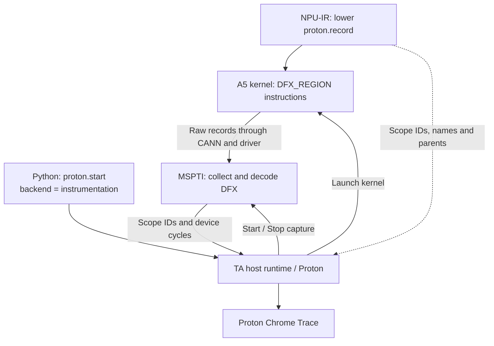

# A5 Proton DFX Capture PoC

This is an experimental three-component integration, not a production-ready
performance measurement path. It requires modified **TA, MSPTI and NPU-IR**.
A stock MSPTI library does not export the new DFX APIs.

MSPTI proposal: [Ascend/mspti #259](https://gitcode.com/Ascend/mspti/merge_requests/259),
branch `chnjz233/mspti:feat/proton-a5-dfx-capture` (commit `23f3238`).



The compiler emits instructions and static metadata; it does not parse runtime
DFX data. TA starts/stops collection around kernel execution, calls MSPTI to
retrieve paired records, and maps scope IDs back to names. The Python launch
interface remains `proton.start(..., backend="instrumentation", data="trace")`.
No `msprof op` launcher or injector is required. CANN and driver libraries remain
dependencies. A3 keeps its existing software circular-buffer path.

## Required Component Versions

- MSPTI must export `msptiDfxStart`, `msptiDfxStop`, `msptiDfxGetRecords`,
  `msptiDfxGetRawData` and `msptiDfxDestroy` from the experimental DFX branch.
- NPU-IR must export Proton metadata format version 2 and insert the DFX drain
  sequence at the actual kernel return. Scope IDs >= `0x188` are reserved.
- Current positive tests use `PROTON_DFX_DIAGNOSTIC_SPACING` when building the
  NPU-IR device template. This is not a TA environment setting, and it is not
  enabled automatically by TA.

## Run

Build TA with Proton enabled, source the matching CANN environment, and select
the modified NPU-IR runtime and MSPTI library:

```bash
export PATH=/path/to/npuir-diagnostic/bin:$PATH
export TRITON_MSPTI_DFX_LIBRARY=/path/to/mspti/build/libmspti.so
export TRITON_DFX_DEBUG_DIR=/path/to/dfx-raw
export TRITON_CACHE_DIR=/path/to/new-cache-for-this-template
python3 third_party/ascend/unittest/proton_ut/proton_a5_dfx_poc.py \
  --n 4097 --lifecycle --output /path/to/dfx-results
```

Use an idle device and do not run other profilers concurrently. This DFX path
loads its library explicitly; do not preload a conflicting MSPTI build. Changing
NPU-IR template binaries requires a fresh Triton cache. The default test does not
skip the first instrumented launch; `--warmup-instrumented` explicitly skips one
capture for diagnostics and never silently replays a user kernel.

Outputs include `proton-dfx.chrome_trace`, `metadata.json`,
`kernel.ttadapter.mlir` and `summary.json`. Raw channel bytes and integrity
statistics are saved under `TRITON_DFX_DEBUG_DIR`.

## Current Evidence and Open Issues

On A5, two captures separated by deactivate/activate produced 32 events for
4097 elements and 448 events for 65537 elements with diagnostic spacing.
Observed records passed pairing, nesting, cycle conversion and host-scope checks.
Event counts are not kernel-launch counts or proof of complete CTA coverage.

Without spacing, raw record blocks can be lost. Diagnostic NOPs significantly
perturb device timing, and channel shutdown can be slow. Therefore the current
trace validates functionality, not unperturbed kernel performance. No synthetic
end records, fixed timing compensation or host-time fallback is applied.

Tracks are explicitly labeled DFX channel/pipe and are channel-relative, not a
host-synchronized cross-core timeline. Mixed frequencies and concurrent capture
are rejected in this PoC. A reliable low-overhead drain protocol, shared MSPTI
channel ownership and broader regression coverage are required before release.

The submission port passed 127 compiler contract tests (28 skipped), the
standalone MSPTI decoder test and formatting checks. The A5 evidence above is
from the preceding private three-component build, not a complete rebuild of
all components on the updated PR2954 branch.
